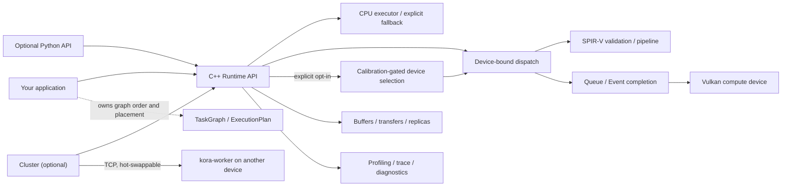
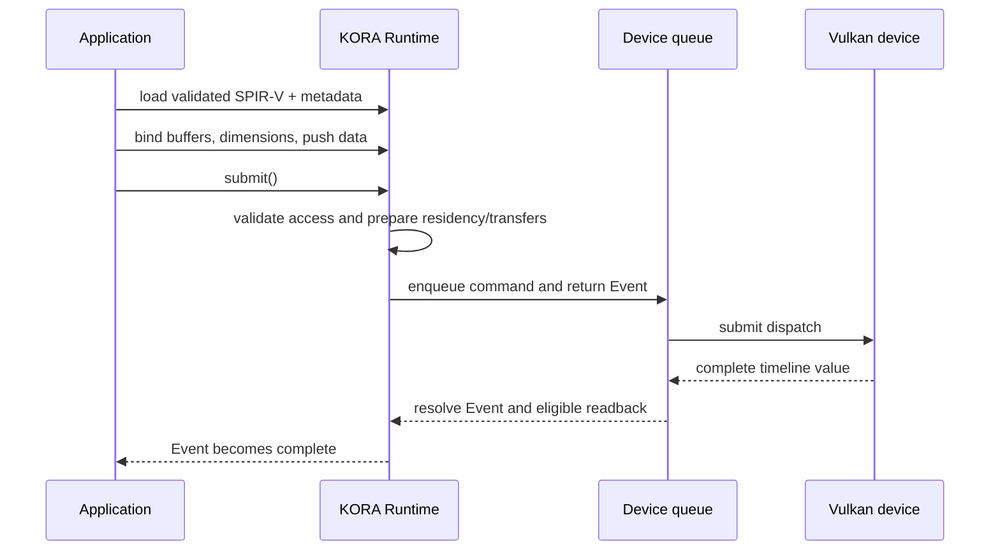
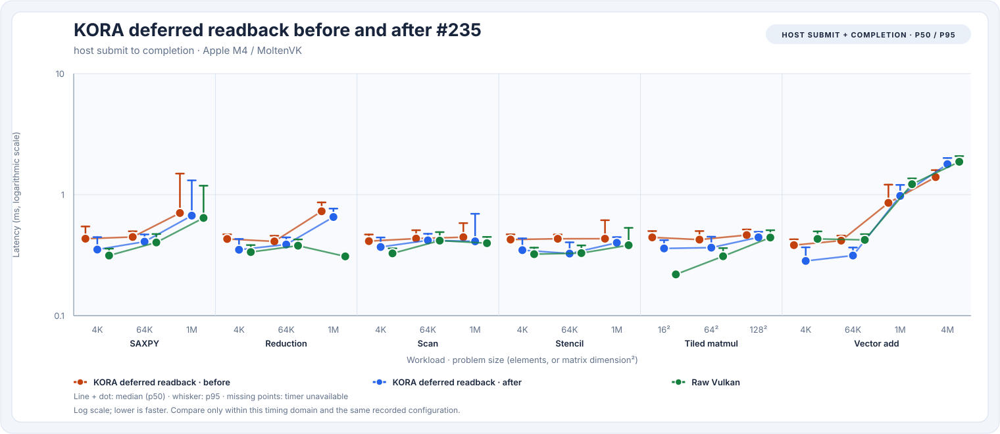
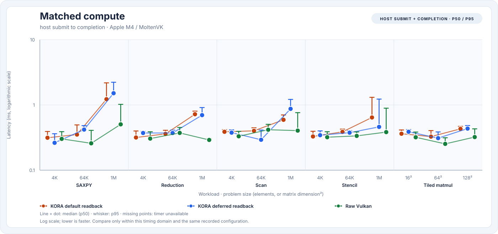
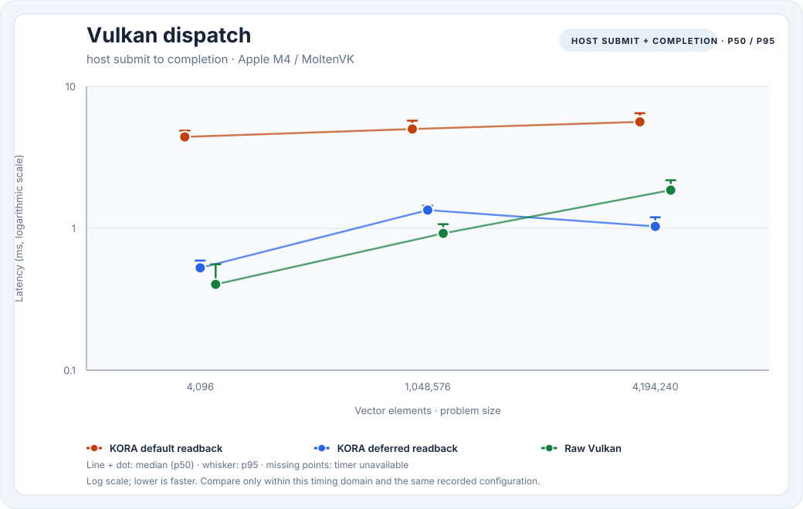
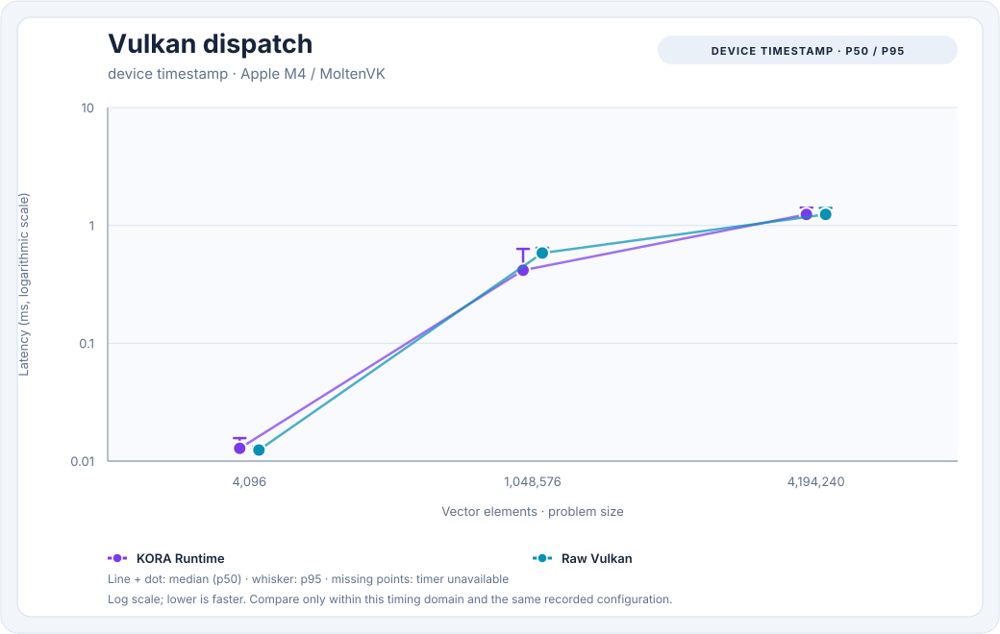
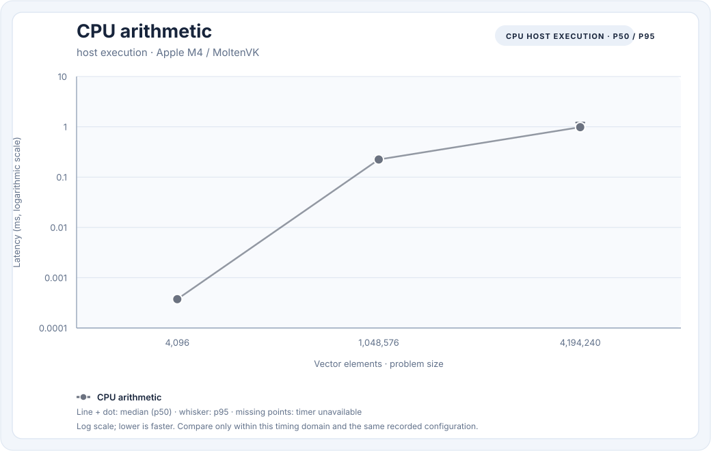

# KORA

**K**ernel **O**ffload **R**untime **A**rchitecture is a C++20 runtime for explicit CPU and Vulkan
compute workloads. It gives applications building blocks for device-bound kernels, buffers,
transfers, events, task graphs, and diagnostics while keeping Vulkan capabilities—and their limits—
visible to the caller.

[](https://github.com/varunkarthic/kora/actions/workflows/ci.yml)
[](https://github.com/varunkarthic/kora/releases)
[](LICENSE)
[](https://kora.readthedocs.io/en/latest/)

> **Maturity:** KORA is in active development. Releases are evaluation builds, not a production
> suitability guarantee. The v0.2.x line is tracked by the [`v0.2` milestone](https://github.com/varunkarthic/kora/milestone/20);
> GitHub release automation publishes patch versions and keeps the line Beta until its validation
> issues are closed.

## What KORA does

- Loads and validates prebuilt SPIR-V compute kernels and caches Vulkan pipelines.
- Manages host shadows, per-device buffer replicas, transfers, queue work, and completion events.
- Provides task-graph dependency analysis and reusable callback plans for caller-controlled
  orchestration.
- Offers CPU execution/fallback, multi-device primitives, profiling, trace export, recovery
  diagnostics, and a thin optional Python API.
- Offloads dispatches to KORA workers on other machines or devices you own with `kora::Cluster`.
  Workers can be connected, unplugged, or reconnected while work is running; a dispatch whose
  worker disappears re-runs locally, so results are never lost or corrupted
  ([remote workers and hot-swap](docs/cluster.md)).
- Uses Vulkan as a vendor-neutral GPU interface; it does not require CUDA, ROCm/HIP, oneAPI, or
  OpenCL.

KORA is explicit by default: a loaded kernel is bound to a Runtime device, and task graphs replay
caller-owned callbacks. Applications may opt into deterministic, calibration-gated placement for an
individual dispatch with `Runtime::dispatch_adaptive()`; it requires an explicit workload description
and `DevicePolicy::AllEligible` to consider more than one device. It does not automatically schedule
arbitrary graph work across CPUs and GPUs. See [what is implemented](docs/overview.md) and the
[platform support matrix](docs/platform-support.md) before choosing it for a workload.

## Architecture at a glance



### A dispatch lifecycle



The Event covers dispatch completion and, by default, writable-output readback. Deferred readback
keeps results device-resident until the caller requests them. See the [Runtime API guide](docs/api/runtime.md)
for lifetime, buffer, and error contracts.

## Quick start

Requirements: CMake 3.21+, Ninja, a C++20 compiler, and Git. A Vulkan loader/compute implementation
is needed only for GPU execution; KORA resolves the loader at runtime, so a CPU-only machine can
still build the library and run applicable tests.

```sh
git clone https://github.com/varunkarthic/kora.git
cd kora
cmake --preset debug
cmake --build --preset debug --parallel
ctest --preset debug --output-on-failure
```

For an optimized build and installable CMake package:

```sh
cmake --preset release
cmake --build --preset release --parallel
ctest --preset release --output-on-failure
cmake --install build/release --prefix "$PWD/install"
```

Link an application to the exported target:

```cmake
find_package(kora CONFIG REQUIRED)
target_link_libraries(my_app PRIVATE kora::kora)
```

The package and first-dispatch walkthrough are in [Getting started](docs/getting-started.md); all
options and build presets are in [Building](docs/building.md).

## Performance snapshot

These are measured local Release results on one Apple M4 (AppleClang 21; KORA on MoltenVK unless
noted), not portable promises. Every chart and table is rendered by [`tools/kora-bench`](tools/kora-bench)
from raw JSON retained in [`benchmarks/results`](benchmarks/results); nothing is hand-drawn or
estimated. Dots are p50 and whiskers p95 on a logarithmic axis. Host submit-to-completion, device
timestamps, and CPU execution are separate timing domains. KORA *default* reads writable outputs
back to the host; KORA *deferred*, raw Vulkan, Metal, and OpenCL leave outputs in device-visible
memory. Single runs on this machine vary by up to several-fold with GPU clock state, so every
comparison below interleaves runs and reports medians across them. No CUDA, Linux, or Windows
hardware result is claimed; see the [benchmark guide](docs/benchmarking.md) for methodology.

### How KORA compares with other APIs on the same GPU

Six interleaved runs each of `kora-bench` and the optional
[`competitor-bench`](docs/benchmark-competitors.md) (Metal, OpenCL 1.2, OpenGL 4.1, Accelerate), with
identical kernels, sizes, inputs, and output checks. Host submit-to-completion, median of per-run p50:

| Workload | KORA deferred | Raw Vulkan | Metal | OpenCL 1.2 | OpenGL 4.1 |
| --- | ---: | ---: | ---: | ---: | ---: |
| SAXPY, 4K | 342 µs | 315 µs | 198 µs | 217 µs | 360 µs |
| Stencil, 64K | 375 µs | 326 µs | 208 µs | 180 µs | 335 µs |
| Tiled matmul, 128² | 491 µs | 444 µs | 224 µs | 233 µs | 346 µs* |
| SAXPY, 1M | 673 µs | 897 µs | 484 µs | 513 µs | 695 µs |
| Vector add, 4M | **1.03 ms** | 1.58 ms | 1.36 ms | 1.37 ms | 1.80 ms |

\* OpenGL 4.1 has no compute shaders; its matmul, reduction, and scan are vertex-shader emulations.


Native Metal is the fastest GPU path for small dispatches; KORA deferred is 1.0–2.2× Metal there
(typically 1.7–2.0×) and 1.15–2.2× at 1M elements, and the fastest path of all on the 4M vector add
(0.76× Metal). Raw Vulkan pays the same
120–150 µs over Metal, so most of that gap is the Vulkan-on-Metal layer (MoltenVK), not KORA, which
is now level with raw Vulkan on most small cases. The same GPU through the KosmicKrisp Vulkan driver
(`KORA_DEVICE=0`) brings KORA within about 15–30% of Metal for most small dispatches, but lacks GPU
timestamps, so it is not the default. Full tables (including device time and Accelerate vs KORA's
CPU baselines): [KORA vs Metal, OpenCL, OpenGL, and Accelerate](docs/benchmark-competitors.md).

### What recent optimizations changed

Each change below was measured with interleaved before/after builds; the change column is the
median per-pair change in p50.

| Change | Effect on KORA (host submit to completion) |
| --- | --- |
| [#227](docs/benchmarking.md#issue-227-unified-memory-direct-access) unified-memory direct access | Default readback 15–60% faster in all 19 cases (15 pairs); deferred SAXPY 37–46% faster; deferred vector add with 16 MiB buffers 10–26% slower |
| [#235](docs/benchmarking.md#issue-235-gpu-timestamps-only-when-needed) GPU timestamps only when needed | All 38 cells faster, 2–27%, no regressions (10 pairs) |
| [#231](https://github.com/varunkarthic/kora/issues/231) free released device buffers | Device allocations no longer grow with every created buffer (5 → 152 live allocations before the fix) |




### Remote workers

`kora::Cluster` offloads dispatches to `kora-worker` processes and survives workers being unplugged
and replugged mid-stream (a randomized test restarts the worker every 5–60 ms while hundreds of
dependent dispatches run, and every result must be exact). Cost of offloading over loopback to a
worker on the same GPU, five runs of 300 samples:

| SAXPY | Local p50 | Remote (loopback) p50 |
| ---: | ---: | ---: |
| 4K | 335 µs | 431 µs |
| 64K | 417 µs | 650 µs |
| 1M | 664 µs | 4.76 ms |

Small dispatches cost one extra round trip; large ones pay for moving their output back, so
offloading helps when the other device is much faster or the local one is busy. A real USB-C or LAN
link adds its own latency. See [remote workers and hot-swap](docs/cluster.md).

### Current snapshot

One 1,000-sample, 50-warm-up run at source 0a71f8c
([raw JSON](benchmarks/results/macos-arm64-apple-m4-moltenvk-snapshot-1000x50-0a71f8c.json),
[generated tables](docs/benchmark-compute-results.md)). Use the interleaved studies above, not this
single run, to compare builds or APIs.









Earlier optimization studies ([#196 dispatch overhead](docs/benchmarking.md#dispatch-overhead-case-study),
[#214 completion latency](docs/benchmarking.md#issue-214-eager-submission-coalescing-and-completion-latency))
and the optional [external CUDA report contract](docs/benchmarking.md#optional-external-cuda-reference)
are in the benchmark guide.

## Documentation

Start with [Overview](docs/overview.md), then choose a path:

| If you want to… | Start here |
| --- | --- |
| Build, install, and run tests | [Getting started](docs/getting-started.md) · [Building](docs/building.md) · [Testing](docs/testing.md) |
| Understand the boundaries and ownership model | [Architecture](docs/architecture.md) · [Invariants](docs/internals/invariants.md) |
| Select devices and manage buffers/transfers | [Device selection](docs/device-selection.md) · [Memory model](docs/memory-model.md) |
| Use every local GPU and remote workers, hot-swappably | [Multi-device, remote workers, and hot-swap](docs/cluster.md) |
| Load kernels and dispatch work | [Kernel format](docs/kernel-format.md) · [Runtime API](docs/api/runtime.md) |
| Profile or compare performance | [Profiling](docs/profiling.md) · [Benchmarking](docs/benchmarking.md) · [vs Metal/OpenCL/OpenGL](docs/benchmark-competitors.md) |
| Diagnose failures or device loss | [Debugging](docs/debugging.md) · [Recovery](docs/recovery.md) |
| Use Python | [Python API](docs/python-api.md) |
| Check release status and installation | [Releases](docs/releases.md) · [Platform support](docs/platform-support.md) |

The full, searchable handbook is published on [Read the Docs](https://kora.readthedocs.io/en/latest/).

## Releases and compatibility

[`VERSION`](VERSION) contains `MAJOR.MINOR`; successful main-branch CI triggers release automation,
which increments the patch from existing tags (`0.2.0`, `0.2.1`, …). A release is Beta while any
issue in its matching `vMAJOR.MINOR` milestone is open, and Stable only after every issue in that
release line is closed. Stable describes completion of repository validation gates, not a guarantee
for every application or GPU. See [release policy](docs/releases.md) and [CHANGELOG](CHANGELOG.md).

## Project and security policy

KORA is a solo-maintained project and does not accept external feature/support issues or pull
requests. Please use published releases and documentation as provided. Report vulnerabilities
privately as described in [SECURITY.md](SECURITY.md).

## License

Apache-2.0; see [LICENSE](LICENSE).
