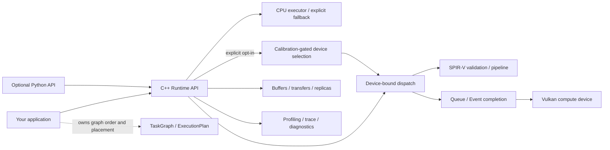
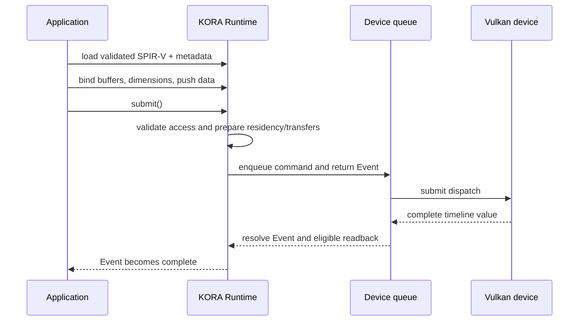

# KORA

**K**ernel **O**ffload **R**untime **A**rchitecture is a C++20 runtime for explicit CPU and Vulkan
compute workloads. It gives applications building blocks for device-bound kernels, buffers,
transfers, events, task graphs, and diagnostics while keeping Vulkan capabilities—and their limits—
visible to the caller.

[](https://github.com/varunkarthic/kora/actions/workflows/ci.yml)
[](https://github.com/varunkarthic/kora/releases)
[](LICENSE)
[](https://kora.readthedocs.io/en/latest/)

> **Maturity:** KORA is in active development. Releases are evaluation builds, not a production
> suitability guarantee. The v0.2.x line is tracked by the [`v0.2` milestone](https://github.com/varunkarthic/kora/milestone/20);
> GitHub release automation publishes patch versions and keeps the line Beta until its validation
> issues are closed.

## What KORA does

- Loads and validates prebuilt SPIR-V compute kernels and caches Vulkan pipelines.
- Manages host shadows, per-device buffer replicas, transfers, queue work, and completion events.
- Provides task-graph dependency analysis and reusable callback plans for caller-controlled
  orchestration.
- Offers CPU execution/fallback, multi-device primitives, profiling, trace export, recovery
  diagnostics, and a thin optional Python API.
- Uses Vulkan as a vendor-neutral GPU interface; it does not require CUDA, ROCm/HIP, oneAPI, or
  OpenCL.

KORA is explicit by default: a loaded kernel is bound to a Runtime device, and task graphs replay
caller-owned callbacks. Applications may opt into deterministic, calibration-gated placement for an
individual dispatch with `Runtime::dispatch_adaptive()`; it requires an explicit workload description
and `DevicePolicy::AllEligible` to consider more than one device. It does not automatically schedule
arbitrary graph work across CPUs and GPUs. See [what is implemented](docs/overview.md) and the
[platform support matrix](docs/platform-support.md) before choosing it for a workload.

## Architecture at a glance



### A dispatch lifecycle



The Event covers dispatch completion and, by default, writable-output readback. Deferred readback
keeps results device-resident until the caller requests them. See the [Runtime API guide](docs/api/runtime.md)
for lifetime, buffer, and error contracts.

## Quick start

Requirements: CMake 3.21+, Ninja, a C++20 compiler, and Git. A Vulkan loader/compute implementation
is needed only for GPU execution; KORA resolves the loader at runtime, so a CPU-only machine can
still build the library and run applicable tests.

```sh
git clone https://github.com/varunkarthic/kora.git
cd kora
cmake --preset debug
cmake --build --preset debug --parallel
ctest --preset debug --output-on-failure
```

For an optimized build and installable CMake package:

```sh
cmake --preset release
cmake --build --preset release --parallel
ctest --preset release --output-on-failure
cmake --install build/release --prefix "$PWD/install"
```

Link an application to the exported target:

```cmake
find_package(kora CONFIG REQUIRED)
target_link_libraries(my_app PRIVATE kora::kora)
```

The package and first-dispatch walkthrough are in [Getting started](docs/getting-started.md); all
options and build presets are in [Building](docs/building.md).

## Performance snapshot

These are captured local Release measurements, not portable promises. The comparison separates
single-thread CPU arithmetic from KORA-on-Vulkan and raw Vulkan host-submit/completion times. These
are not kernel-only GPU times; rerun on each target OS, compiler, driver, device, and workload. The
[benchmark guide](docs/benchmarking.md) includes the methodology and limitations.

These generated charts use separate panels for CPU arithmetic, host completion, and device
timestamps. Lines and dots show p50; whiskers extend to p95. Each panel uses a logarithmic latency
axis with units selected for its range. Missing device timestamps remain visibly unavailable rather
than being estimated. This single Apple M4/MoltenVK sample is not CUDA or cross-platform performance
evidence.


| Elements | CPU median | KORA default | KORA deferred | Raw Vulkan | KORA GPU | Raw GPU |
| ---: | ---: | ---: | ---: | ---: | ---: | ---: |
| 4096 | 375 ns | 2.259 ms | 595.208 µs | 404.667 µs | 14.041 µs | 21.334 µs |
| 1048576 | 224.375 µs | 2.517 ms | 799.750 µs | 996 µs | unavailable | 359.125 µs |
| 4194240 | 984.125 µs | 2.942 ms | 2.349 ms | 1.964 ms | unavailable | 1.315 ms |

Benchmark sample: 100 measured iterations after 10 warm-ups on macOS arm64 / Apple M4, AppleClang 21
Release; GPU paths were pinned to device 2 (MoltenVK, Vulkan 1.3.357). KORA default includes output
readback, while deferred KORA and raw Vulkan keep outputs device-resident. CPU arithmetic, host
submit/completion, and GPU timestamp columns are different timing domains; timestamp results are
unavailable for two KORA sizes on this device. No CUDA comparison is available from this non-CUDA
device. Full workload definitions and caveats are in
[Benchmarking](docs/benchmarking.md).

The retained table is currently one macOS/MoltenVK machine sample. Linux, Windows, and macOS are
build/test targets, but CI smoke coverage is not a cross-OS performance study; no Linux/Windows
hardware-GPU or CUDA result is claimed. The benchmark guide explains how to distinguish CPU
arithmetic, software Vulkan, hardware-GPU timestamps, and KORA host overhead.

The subsequent #196 dispatch-path optimization was measured separately against raw Vulkan on the
same Apple M4/MoltenVK device. In 1,000-sample Release runs, 4K deferred-readback KORA changed from
676.5 µs to 524.0 µs median (raw Vulkan: 346.9 µs to 406.7 µs). The KORA/raw host-latency ratio
changed from 1.95× to 1.29×. These sequential local runs show host-load variation and do not establish
CUDA parity; raw JSON, exact revisions, and the profiling breakdown are in
[the dispatch-overhead study](docs/benchmarking.md#dispatch-overhead-case-study).

## Documentation

Start with [Overview](docs/overview.md), then choose a path:

| If you want to… | Start here |
| --- | --- |
| Build, install, and run tests | [Getting started](docs/getting-started.md) · [Building](docs/building.md) · [Testing](docs/testing.md) |
| Understand the boundaries and ownership model | [Architecture](docs/architecture.md) · [Invariants](docs/internals/invariants.md) |
| Select devices and manage buffers/transfers | [Device selection](docs/device-selection.md) · [Memory model](docs/memory-model.md) |
| Load kernels and dispatch work | [Kernel format](docs/kernel-format.md) · [Runtime API](docs/api/runtime.md) |
| Profile or compare performance | [Profiling](docs/profiling.md) · [Benchmarking](docs/benchmarking.md) |
| Diagnose failures or device loss | [Debugging](docs/debugging.md) · [Recovery](docs/recovery.md) |
| Use Python | [Python API](docs/python-api.md) |
| Check release status and installation | [Releases](docs/releases.md) · [Platform support](docs/platform-support.md) |

The full, searchable handbook is published on [Read the Docs](https://kora.readthedocs.io/en/latest/).

## Releases and compatibility

[`VERSION`](VERSION) contains `MAJOR.MINOR`; successful main-branch CI triggers release automation,
which increments the patch from existing tags (`0.2.0`, `0.2.1`, …). A release is Beta while any
issue in its matching `vMAJOR.MINOR` milestone is open, and Stable only after every issue in that
release line is closed. Stable describes completion of repository validation gates, not a guarantee
for every application or GPU. See [release policy](docs/releases.md) and [CHANGELOG](CHANGELOG.md).

## Project and security policy

KORA is a solo-maintained project and does not accept external feature/support issues or pull
requests. Please use published releases and documentation as provided. Report vulnerabilities
privately as described in [SECURITY.md](SECURITY.md).

## License

Apache-2.0; see [LICENSE](LICENSE).
