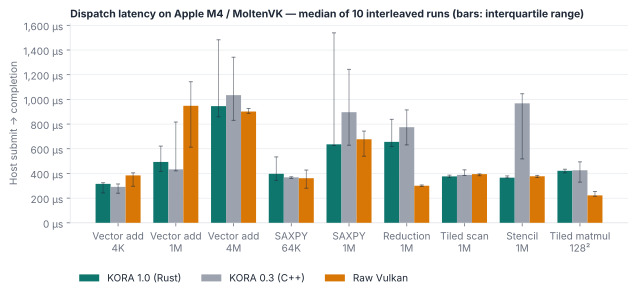
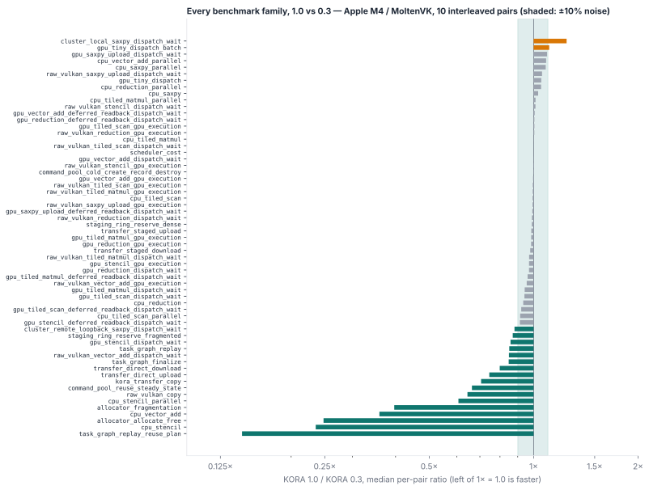

<p align="center">
  
</p>

<h1 align="center">KORA</h1>

<p align="center">
  <strong>Vendor-neutral Vulkan compute you can reason about — in Rust, C, or Python.</strong><br>
  From one GPU to several devices you can plug in and out, without losing a result.
</p>

<p align="center">
  <a href="https://github.com/varunkarthic/kora/actions/workflows/ci.yml"></a>
  <a href="https://github.com/varunkarthic/kora/releases"></a>
  <a href="https://kora.readthedocs.io/en/latest/"></a>
  <a href="LICENSE"></a>
</p>

<p align="center">
  <a href="https://kora.readthedocs.io/en/latest/get-started/">Get started</a> ·
  <a href="https://kora.readthedocs.io/en/latest/get-started/quickstart/">First dispatch</a> ·
  <a href="https://kora.readthedocs.io/en/latest/guides/">Guides</a> ·
  <a href="https://kora.readthedocs.io/en/latest/api/">API</a> ·
  <a href="https://kora.readthedocs.io/en/latest/performance/">Performance</a>
</p>

---

KORA turns explicit Vulkan compute into **buffers, kernels, and events**. Every buffer keeps an
authoritative host copy, so a dispatch can run on any local GPU or on a remote worker, and a device
can disappear mid-stream without losing or corrupting a result.

- **Explicit by default.** Kernels are validated SPIR-V bound to a device. You decide where work runs
  and when bytes move; capabilities and limits stay visible.
- **Hot-swappable devices.** A `Cluster` routes dispatches across every local GPU and remote
  `kora-worker`s, splits large ones, and re-runs work locally when a worker is unplugged.
- **Three APIs, one core.** A Rust crate, a stable C ABI (`libkora` + `kora.h`), and an abi3 Python
  wheel with NumPy and asyncio support.
- **Vendor-neutral.** Plain Vulkan: no CUDA, ROCm/HIP, oneAPI, or OpenCL. Decisions use queried
  capabilities and measurements, never vendor IDs.
- **Observable.** GPU timestamps, per-phase host profiles, Chrome traces, and `kora-top`, a live view
  of devices, workers, memory, and failovers.

## Quick start

```sh
git clone https://github.com/varunkarthic/kora.git
cd kora
cargo run --release -p kora --example vector_add
```

Expected result: `vector add of 1048576 elements: 0 mismatches` on your first Vulkan device. No GPU?
The crate still builds, and runtime creation reports `NoVulkanImplementation`; on Linux, Mesa's
`lavapipe` gives you a software device.

```rust
use kora::kernel::spirv::words_from_bytes;
use kora::{parse_kernel_metadata, Runtime, RuntimeOptions};

let runtime = Runtime::new(&RuntimeOptions::default())?;
let kernel = runtime.load_kernel(
    &words_from_bytes(include_bytes!("examples/kernels/vector_add.spv"))?,
    "main",
    parse_kernel_metadata(include_str!("examples/kernels/vector_add.json"))?,
)?;
let a = runtime.create_buffer::<u32>(n)?;
let b = runtime.create_buffer::<u32>(n)?;
let sums = runtime.create_buffer::<u32>(n)?;
a.write(&left)?;
b.write(&right)?;
runtime.dispatch(&kernel).global(n).read(&a).read(&b).write(&sums)
    .push(&(n as u32))
    .submit()?
    .wait()?;
let result = sums.read()?;
```

The same example in [C](crates/kora-capi/examples/vector_add.c) and
[Python](examples/vector_add.py), and how to install each, are in
[Get started](https://kora.readthedocs.io/en/latest/get-started/).

## Spread work across devices

```rust
use kora::{Cluster, ClusterOptions};

let cluster = Cluster::new(ClusterOptions {
    workers: vec!["gpu-box.local:7400".into()],   // started with `kora-worker --listen 0.0.0.0:7400`
    ..ClusterOptions::default()
})?;
let kernel = cluster.load_kernel(&words, "main", metadata)?;
cluster.dispatch(&kernel).global(n).read(&x).read_write(&y).push(&params)
    .split(4)   // divide large dispatches across devices by measured throughput
    .submit()?;
```

Workers can start before or after the Cluster and can be unplugged at any time: their work re-runs
locally and results are committed only if the host copy has not changed. Watch it with
`kora-top --demo`. See [Multiple devices and remote workers](https://kora.readthedocs.io/en/latest/guides/cluster/).

## Performance

KORA 1.0 is a Rust rewrite of the 0.3 C++ runtime, so the two were measured against each other on
the same GPU before release: ten ABBA-interleaved pairs of `kora-bench --gpu --cluster` on an Apple M4,
for both of its Vulkan drivers. Every chart and number below is generated by
[`tools/bench-report/render.py`](tools/bench-report/render.py) from the retained reports in
[`benchmarks/results/rust-vs-cpp-apple-m4`](benchmarks/results/rust-vs-cpp-apple-m4)
(<!-- bench:revisions -->
C++ 0.3 `e07fd51` and Rust 1.0 `f03431c`
<!-- /bench:revisions -->).

<picture>
  <source media="(prefers-color-scheme: dark)" srcset="docs/assets/charts/readme-dispatch-moltenvk-dark.svg">
  
</picture>

Host submit-to-completion latency with deferred readback, median of each run's p50 across 10 runs,
MoltenVK. "1.0 vs 0.3" is the median of per-pair ratios.

<!-- bench:dispatch -->
| Workload | Size | KORA 1.0 | KORA 0.3 | 1.0 vs 0.3 | Raw Vulkan |
| --- | ---: | ---: | ---: | ---: | ---: |
| Vector add | 4K | 315 µs | 291 µs | +4% | 384 µs |
| Vector add | 1M | 493 µs | 434 µs | +2% | 948 µs |
| Vector add | 4M | 946 µs | 1.03 ms | +1% | 902 µs |
| SAXPY | 64K | 397 µs | 369 µs | +2% | 361 µs |
| SAXPY | 1M | 636 µs | 896 µs | -1% | 677 µs |
| Reduction | 1M | 656 µs | 775 µs | -3% | 300 µs |
| Tiled scan | 1M | 376 µs | 389 µs | -4% | 394 µs |
| Stencil | 1M | 366 µs | 968 µs | -34% | 377 µs |
| Tiled matmul | 128² | 421 µs | 426 µs | -2% | 222 µs |
<!-- /bench:dispatch -->

Host-side work that 1.0 made faster:

<!-- bench:host -->
| Operation | KORA 1.0 | KORA 0.3 | Change |
| --- | ---: | ---: | ---: |
| Task graph: finalize 64 tasks | 12 µs | 14 µs | -15% |
| Task graph: build, plan, replay 64 | 6.3 µs | 7.4 µs | -15% |
| Staging ring: reserve with 512 live ranges | 125 ns | 1.2 µs | -89% |
| Allocator: 256 allocations and frees | 32 µs | 131 µs | -75% |
| CPU stencil, 1M elements | 155 µs | 657 µs | -76% |
<!-- /bench:host -->

Offloading through a `Cluster` to a worker on the same GPU over loopback (1.0, MoltenVK):

<!-- bench:cluster -->
| SAXPY | Local | Remote worker (loopback) |
| ---: | ---: | ---: |
| 4K | 333 µs | 429 µs |
| 64K | 366 µs | 557 µs |
| 1M | 1.12 ms | 3.56 ms |
<!-- /bench:cluster -->

<picture>
  <source media="(prefers-color-scheme: dark)" srcset="docs/assets/charts/readme-families-moltenvk-dark.svg">
  
</picture>

<!-- bench:families -->
MoltenVK: 62 benchmark families — 17 faster than 0.3 by more than 10%, 42 within ±10%, 3 slower by more than 10% (`cluster_local_saxpy_dispatch_wait`, `gpu_tiny_dispatch_batch`, `host_allocation_4k`).

KosmicKrisp: 51 benchmark families — 11 faster than 0.3 by more than 10%, 37 within ±10%, 3 slower by more than 10% (`host_allocation_4k`, `transfer_staged_download`, `transfer_staged_upload`).
<!-- /bench:families -->

How to read these: a single run on this machine can move several-fold with GPU clock state, so
only interleaved pairs are compared, and families whose code is identical in both builds vary by
about ±10% between repeated sets. Known gaps (Cluster local dispatch, the tiny-dispatch case, and
SAXPY at 1M with default readback on MoltenVK) are tracked in
[#263](https://github.com/varunkarthic/kora/issues/263); KORA's 3–4× longer device time than raw
Vulkan for some 1M-element kernels on MoltenVK predates 1.0
([#229](https://github.com/varunkarthic/kora/issues/229)). No Linux, Windows, or CUDA comparison is
claimed. Details: [Performance](https://kora.readthedocs.io/en/latest/performance/).

## Documentation

| If you want to… | Read |
| --- | --- |
| Install KORA and run your first dispatch | [Get started](https://kora.readthedocs.io/en/latest/get-started/) |
| Bring your own shader | [Kernels and manifests](https://kora.readthedocs.io/en/latest/guides/kernels/) |
| Understand when bytes move | [Buffers and memory](https://kora.readthedocs.io/en/latest/guides/memory/) |
| Use several GPUs or other machines | [Multiple devices and remote workers](https://kora.readthedocs.io/en/latest/guides/cluster/) |
| Look up a function | [Rust](https://kora.readthedocs.io/en/latest/api/rust/) · [C](https://kora.readthedocs.io/en/latest/api/c/) · [Python](https://kora.readthedocs.io/en/latest/api/python/) |
| Move from the 0.x C++ runtime | [Migrating from 0.x](https://kora.readthedocs.io/en/latest/project/migrating/) |
| Check platform support | [Platform support](https://kora.readthedocs.io/en/latest/project/platform-support/) |

## Project

KORA is maintained by one person and does not accept external issues or pull requests; please use
the releases and documentation as provided. Releases are published from `main`: a line is **Stable**
only when every validation issue in its milestone is closed, otherwise **Beta**
([release policy](https://kora.readthedocs.io/en/latest/project/releases/), [CHANGELOG](CHANGELOG.md)).
Report vulnerabilities privately as described in [SECURITY.md](SECURITY.md).

Licensed under [Apache-2.0](LICENSE).
