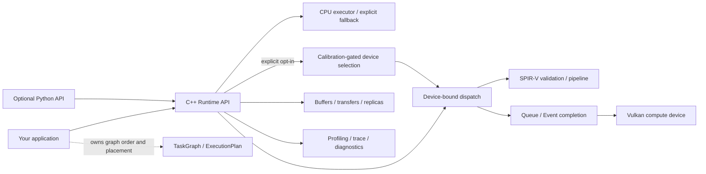
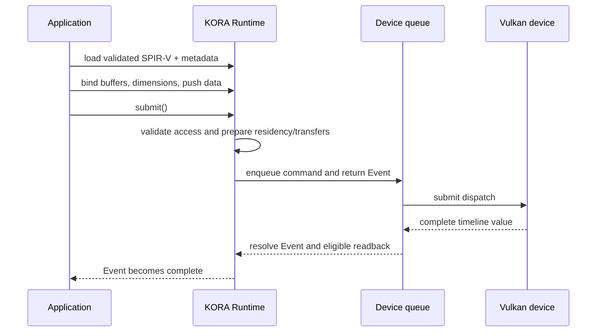

# KORA

**K**ernel **O**ffload **R**untime **A**rchitecture is a C++20 runtime for explicit CPU and Vulkan
compute workloads. It gives applications building blocks for device-bound kernels, buffers,
transfers, events, task graphs, and diagnostics while keeping Vulkan capabilities—and their limits—
visible to the caller.

[](https://github.com/varunkarthic/kora/actions/workflows/ci.yml)
[](https://github.com/varunkarthic/kora/releases)
[](LICENSE)
[](https://kora.readthedocs.io/en/latest/)

> **Maturity:** KORA is in active development. Releases are evaluation builds, not a production
> suitability guarantee. The v0.2.x line is tracked by the [`v0.2` milestone](https://github.com/varunkarthic/kora/milestone/20);
> GitHub release automation publishes patch versions and keeps the line Beta until its validation
> issues are closed.

## What KORA does

- Loads and validates prebuilt SPIR-V compute kernels and caches Vulkan pipelines.
- Manages host shadows, per-device buffer replicas, transfers, queue work, and completion events.
- Provides task-graph dependency analysis and reusable callback plans for caller-controlled
  orchestration.
- Offers CPU execution/fallback, multi-device primitives, profiling, trace export, recovery
  diagnostics, and a thin optional Python API.
- Uses Vulkan as a vendor-neutral GPU interface; it does not require CUDA, ROCm/HIP, oneAPI, or
  OpenCL.

KORA is explicit by default: a loaded kernel is bound to a Runtime device, and task graphs replay
caller-owned callbacks. Applications may opt into deterministic, calibration-gated placement for an
individual dispatch with `Runtime::dispatch_adaptive()`; it requires an explicit workload description
and `DevicePolicy::AllEligible` to consider more than one device. It does not automatically schedule
arbitrary graph work across CPUs and GPUs. See [what is implemented](docs/overview.md) and the
[platform support matrix](docs/platform-support.md) before choosing it for a workload.

## Architecture at a glance



### A dispatch lifecycle



The Event covers dispatch completion and, by default, writable-output readback. Deferred readback
keeps results device-resident until the caller requests them. See the [Runtime API guide](docs/api/runtime.md)
for lifetime, buffer, and error contracts.

## Quick start

Requirements: CMake 3.21+, Ninja, a C++20 compiler, and Git. A Vulkan loader/compute implementation
is needed only for GPU execution; KORA resolves the loader at runtime, so a CPU-only machine can
still build the library and run applicable tests.

```sh
git clone https://github.com/varunkarthic/kora.git
cd kora
cmake --preset debug
cmake --build --preset debug --parallel
ctest --preset debug --output-on-failure
```

For an optimized build and installable CMake package:

```sh
cmake --preset release
cmake --build --preset release --parallel
ctest --preset release --output-on-failure
cmake --install build/release --prefix "$PWD/install"
```

Link an application to the exported target:

```cmake
find_package(kora CONFIG REQUIRED)
target_link_libraries(my_app PRIVATE kora::kora)
```

The package and first-dispatch walkthrough are in [Getting started](docs/getting-started.md); all
options and build presets are in [Building](docs/building.md).

## Performance snapshot

These are captured local Release measurements on one Apple M4 (MoltenVK, Vulkan 1.3.357,
AppleClang 21), not portable promises. Every chart and table here is rendered by
[`tools/kora-bench`](tools/kora-bench) from retained raw JSON in [`benchmarks/results`](benchmarks/results);
nothing is hand-drawn or estimated. Lines and dots show p50, whiskers p95, on a logarithmic latency
axis. CPU arithmetic, host submit-to-completion, and device timestamps are separate timing domains.
KORA default mode reads writable outputs back to the host; deferred KORA and raw Vulkan leave outputs
on the device. No CUDA, Linux, or Windows hardware result is claimed; the
[benchmark guide](docs/benchmarking.md) explains the methodology and limitations.

### Unified-memory direct access (#227)

KORA now detects unified memory from the device's memory heaps and, on such devices, writes inputs
and reads outputs through the buffer's mapping instead of staging every transfer through a separate
submission. Across 15 interleaved before/after pairs on the same device:

- **Default readback** (KORA's default dispatch mode) got 15–60% faster in all 19 matched cases,
  for example 4K SAXPY 1.09 ms → 0.43 ms and 1M vector add 4.30 ms → 1.76 ms.
- **Deferred SAXPY**, which rewrites a large input every call, got 37–46% faster.
- Other deferred compute cases were unchanged within noise (−0% to +6%), and **deferred vector add
  with 16 MiB buffers regressed 10–26%**: MoltenVK's host-visible memory, which direct mapping
  needs, costs more per dispatch than its host-invisible memory.
- KORA device timestamps are now reported for every matched case instead of being intermittently
  dropped.


The [full paired table and method](docs/benchmarking.md#issue-227-unified-memory-direct-access) and all
30 raw reports are retained. KORA kernels at 1M elements still run about 3× longer than raw Vulkan
on MoltenVK by device timestamp (not on KosmicKrisp); that is tracked in
[#229](https://github.com/varunkarthic/kora/issues/229).

### Current snapshot

From one 1,000-sample, 50-warm-up report after #227
([raw JSON](benchmarks/results/macos-arm64-apple-m4-moltenvk-compute-sweep-1000x50-8ca0de7.json),
[generated tables](docs/benchmark-compute-results.md)). Single runs on this device vary by up to
several-fold with GPU clock state, so use the paired study above for before/after conclusions.


| Elements | CPU median | KORA default | KORA deferred | Raw Vulkan | KORA GPU | Raw GPU |
| ---: | ---: | ---: | ---: | ---: | ---: | ---: |
| 4096 | 2.083 µs | 1.264 ms | 268.416 µs | 260.459 µs | 12.834 µs | 12.417 µs |
| 1048576 | 563.166 µs | 2.046 ms | 1.129 ms | 1.247 ms | 416.417 µs | 582.916 µs |
| 4194240 | 2.243 ms | 2.670 ms | 1.790 ms | 1.847 ms | 1.240 ms | 1.239 ms |

Vector add: CPU is single-thread arithmetic; KORA and raw Vulkan columns are host submit-to-completion
medians; GPU columns are device timestamps. The vector-add default column reads back a 16 MiB output
buffer regardless of the dispatched element count. Earlier optimization studies
([#196 dispatch overhead](docs/benchmarking.md#dispatch-overhead-case-study),
[#214 completion latency](docs/benchmarking.md#issue-214-eager-submission-coalescing-and-completion-latency))
and the optional [external CUDA report contract](docs/benchmarking.md#optional-external-cuda-reference)
are documented in the benchmark guide.

## Documentation

Start with [Overview](docs/overview.md), then choose a path:

| If you want to… | Start here |
| --- | --- |
| Build, install, and run tests | [Getting started](docs/getting-started.md) · [Building](docs/building.md) · [Testing](docs/testing.md) |
| Understand the boundaries and ownership model | [Architecture](docs/architecture.md) · [Invariants](docs/internals/invariants.md) |
| Select devices and manage buffers/transfers | [Device selection](docs/device-selection.md) · [Memory model](docs/memory-model.md) |
| Load kernels and dispatch work | [Kernel format](docs/kernel-format.md) · [Runtime API](docs/api/runtime.md) |
| Profile or compare performance | [Profiling](docs/profiling.md) · [Benchmarking](docs/benchmarking.md) |
| Diagnose failures or device loss | [Debugging](docs/debugging.md) · [Recovery](docs/recovery.md) |
| Use Python | [Python API](docs/python-api.md) |
| Check release status and installation | [Releases](docs/releases.md) · [Platform support](docs/platform-support.md) |

The full, searchable handbook is published on [Read the Docs](https://kora.readthedocs.io/en/latest/).

## Releases and compatibility

[`VERSION`](VERSION) contains `MAJOR.MINOR`; successful main-branch CI triggers release automation,
which increments the patch from existing tags (`0.2.0`, `0.2.1`, …). A release is Beta while any
issue in its matching `vMAJOR.MINOR` milestone is open, and Stable only after every issue in that
release line is closed. Stable describes completion of repository validation gates, not a guarantee
for every application or GPU. See [release policy](docs/releases.md) and [CHANGELOG](CHANGELOG.md).

## Project and security policy

KORA is a solo-maintained project and does not accept external feature/support issues or pull
requests. Please use published releases and documentation as provided. Report vulnerabilities
privately as described in [SECURITY.md](SECURITY.md).

## License

Apache-2.0; see [LICENSE](LICENSE).
