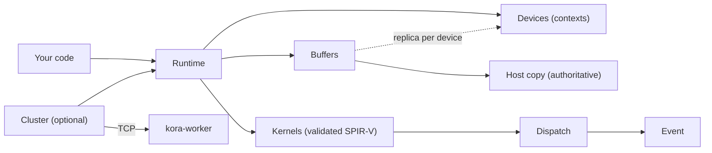

# Core concepts

## Runtime

A `Runtime` owns the Vulkan instance and the devices it selected: one by default, or every eligible
device with `DevicePolicy::AllEligible`. It is thread-safe; share it behind an `Arc` (Rust) or use it
from any thread (C, Python). Dropping it drains queued work, or cancels it with
`KORA_SHUTDOWN_MODE=cancel_pending`.

## Buffers

A buffer is a logical array of bytes with:

- a **host copy**, which is always authoritative and is what `read`, `write`, and `map` see, and
- a **replica** on each device that has used it, created on first use.

Every host write bumps the buffer's *version*. A dispatch uploads an input only when the replica's
version is older than the host's. Outputs are copied back to the host when the dispatch completes,
unless you ask for `defer_readback`, in which case they stay on the device until `readback`. Using a
buffer as a dispatch input on one device while its newest contents live on another is an error, not
a silent stale read. See
[Buffers and memory](../guides/memory.md).

Buffers are independent of their runtime's lifetime: a handle keeps its bytes alive, and submitted
work keeps the buffers it uses alive until it completes.

## Kernels and manifests

A kernel is a SPIR-V compute module plus a **manifest**: its bindings (name, set, binding, access),
push-constant fields, specialization constants, and workgroup size. Loading validates the module
against the manifest and compiles the pipeline for one device. A dispatch must bind buffers in
manifest order with matching access. See [Kernels and manifests](../guides/kernels.md).

## Dispatches and events

`dispatch(kernel)` returns a builder: set the global size, bind buffers, set push constants, then
`submit`. Submission returns an **event**, which you wait on, attach callbacks to, combine with
`Event::when_all`, or `await` in Python. Dispatches that share a buffer are ordered with the right
memory barriers; independent dispatches are not serialized. See
[Dispatch and synchronization](../guides/dispatch.md).

## Explicit placement, optional automation

A kernel is bound to one device, and you choose where work runs. Two opt-in layers automate that:

- `dispatch_adaptive` picks a device for a single dispatch from startup calibration and observed
  timings ([Adaptive placement](../guides/adaptive.md)).
- `Cluster` routes whole dispatches across local devices and remote workers, splits large ones, and
  fails over when a worker disappears ([Multiple devices](../guides/cluster.md)).

KORA does not schedule arbitrary task graphs across devices for you. `TaskGraph` and `ExecutionPlan`
compute an order and replay *your* callbacks ([Task graphs](../guides/task-graphs.md)).

## Errors

Expected failures are values: Rust returns `kora::Result<T>`, C returns a `KoraStatus`, and Python
raises `KoraError` with a `code`. Each carries a stable [`ErrorCode`](../api/errors.md) and, where
known, the device, kernel, task, and Vulkan result involved.
