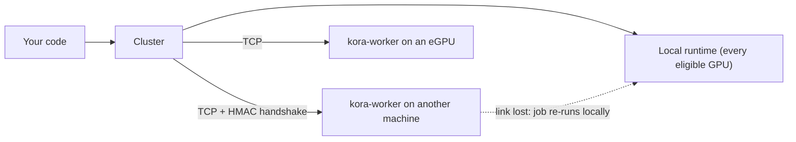

# Multiple devices and remote workers

A `Cluster` is one host runtime plus any number of remote `kora-worker` processes. Buffers always live
on the host. Each dispatch runs where it is expected to finish first, and any remote failure
transparently re-runs it locally, so workers can be started, unplugged, and replugged while work is
running without losing or corrupting a result.



## Start a worker

On the machine with the extra device:

```sh
KORA_WORKER_TOKEN='a long shared secret' kora-worker --listen 0.0.0.0:7400
```

Without a token the worker accepts only clients on the same machine. Traffic is authenticated
(HMAC-SHA256 challenge) and integrity-checked (CRC32C per frame) but **not encrypted**: use a trusted
link or an SSH/VPN tunnel. See [kora-worker](../tools/kora-worker.md).

## Create a Cluster

```rust
use kora::{Cluster, ClusterOptions, OffloadPolicy};

let cluster = Cluster::new(ClusterOptions {
    workers: vec!["192.168.1.20:7400".into()],
    token: "a long shared secret".into(),        // or KORA_WORKER_TOKEN
    policy: OffloadPolicy::Auto,
    ..ClusterOptions::default()
})?;
let kernel = cluster.load_kernel(&words, "main", metadata)?;
let x = cluster.create_buffer::<f32>(n)?;
let y = cluster.create_buffer::<f32>(n)?;
cluster.dispatch(&kernel).global(n).read(&x).read_write(&y).push(&params).submit()?.wait()?;
```

Workers may start before or after the Cluster; absent ones are retried in the background.
`KORA_WORKERS=host:port,host:port` adds endpoints, and `attach`/`detach` change them at run time.
Unless you choose a device policy (or set `KORA_DEVICE`), the local runtime uses every eligible GPU.

## Placement policies

| Policy | Behavior |
| --- | --- |
| `Auto` | Measures each local device once, explores unmeasured workers occasionally, then picks the lowest expected completion time (measured latency × (1 + queued work)). |
| `LocalOnly` | Never offloads; workers stay connected but idle. |
| `PreferRemote` | Uses a connected worker whenever one can run the kernel. |

Dispatches that share buffers are ordered (read-after-write, write-after-read, write-after-write)
across all targets, so a chain of dependent dispatches is correct wherever each step runs.

## Split dispatches

A large one-dimensional dispatch can be divided across several devices:

```rust
cluster.dispatch(&kernel).global(n).read(&x).read_write(&y).push(&params)
    .split(4)   // bytes per element of every written buffer
    .submit()?;
```

The kernel must declare a `u32` push-constant field named `base` and handle element
`base + gl_GlobalInvocationID.x`. Slices are sized by measured throughput, aligned to the workgroup
size, and their results are merged and committed once, so a split dispatch is still all-or-nothing.
Splitting is skipped below `split_min_elements` (65,536) and whenever it is not predicted to beat one
device; it stops after splits measure no faster than the best single device, re-probing occasionally.

## Failover and hot swap

- A worker that disconnects, times out (`request_timeout`), sends a corrupt frame, or fails a job has
  its queued and in-flight jobs re-run locally. Results are committed only if the host copy still has
  the version the job started from.
- Workers reconnect automatically every `reconnect_interval`; a worker caches buffers it has seen, so
  unchanged inputs are not re-sent.
- If a local GPU is lost, the Cluster recreates the local devices once in-flight local work drains,
  keeping every buffer, and retries the job once.
- With every local GPU in use, the Cluster re-enumerates devices every `device_rescan_interval` (5 s)
  and rebuilds when one appears or disappears.

## Observe it

`cluster.workers()`, `local_devices()`, `stats()`, and `events()` report connection state, dispatch
counts, failovers, cached bytes, device memory, and a log of routing changes. Set `status_listen`
(or `KORA_STATUS_LISTEN=127.0.0.1:7979`) to stream the same snapshot as JSON lines for
[`kora-top`](../tools/kora-top.md). Only loopback addresses are accepted, because snapshots name
devices and endpoints.

## Cost of offloading

Over loopback to a worker on the same GPU, a small dispatch costs one extra round trip and a large one
pays for moving its output back; see the `cluster_*` rows in the
[performance results](../performance/rust-vs-cpp.md). Offloading helps when the other device is much
faster or the local one is busy; a real network link adds its own latency.
