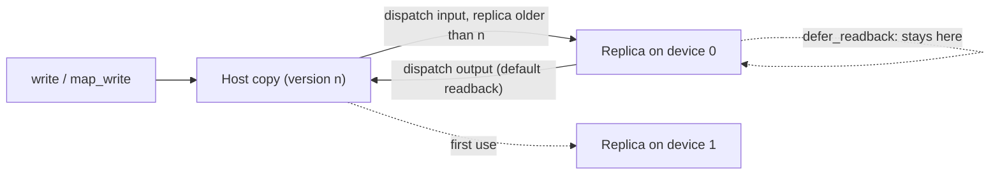

# Buffers and memory

## A buffer is a host copy plus replicas



- **Create** with `runtime.create_buffer::<T>(count)` (typed, `T: bytemuck::Pod`) or
  `create_buffer_bytes(size, usage)`. The host copy starts zeroed; no device memory is allocated
  until a device first uses the buffer.
- **Write** with `write(&[T])`, which must cover the whole buffer, or map a range with
  `map_write_range`. Each write gives the buffer a new **version**.
- **Read** with `read()`, `read_into`, or `map_read`. Reads see the host copy.
- A dispatch **uploads** an input only when its replica holds an older version. A buffer reused by
  consecutive dispatches on one device is uploaded once.

Versions are unique across all buffers, so a late device result can never be mistaken for a newer
host write: a result is committed to the host copy only if the host still holds the version the
dispatch started from. If you write the buffer while its dispatch runs, your write wins.

## Mapping

`map_read` and `map_write` return guards that give direct access to the host copy:

```rust
{
    let mut view = buffer.map_write()?;   // &mut [u8]
    view[..4].copy_from_slice(&1u32.to_le_bytes());
}                                          // guard dropped: mapping ends
```

While a thread holds a mapping, other threads wait for it, and the same thread gets an
`InvalidArgument` error instead of deadlocking. A device result that arrives while the buffer is
mapped is parked and applied on its next access, so completion never blocks on your mapping.

In Python, `buffer.map()` returns a `MappedView` that supports the buffer protocol, so
`numpy.frombuffer(memoryview(view), dtype)` is a zero-copy NumPy view. The view belongs to the thread
that created it; call `view.release()` (after releasing the memoryviews) or let it be collected.

## Keeping results on the device

By default, a dispatch's written buffers are copied back to their host copies before its event
completes. For a chain of dispatches, skip those copies:

```rust
runtime.dispatch(&blur).global(n).read(&image).write(&tmp).defer_readback().submit()?;
runtime.dispatch(&sharpen).global(n).read(&tmp).write(&out).defer_readback().submit()?;
runtime.readback(&out)?.wait()?;   // copy just the final result
```

`tmp` never travels to the host. Using `tmp` on a *different* device before reading it back is an
error (`InvalidArgument`), because the newest contents exist only on the first device.

## Memory placement

KORA classifies each device's memory from its heaps and types, never from vendor identity:

| Topology | Detected when | Effect |
| --- | --- | --- |
| `Discrete` | device-local memory is not host-visible | uploads and readbacks go through staging buffers |
| `Uma` | device-local memory is host-visible and there is no separate system heap | buffers live in host-visible memory; dispatches copy inputs and outputs through the mapping directly |
| `DiscreteWithBar` | both kinds exist plus a system heap | treated as discrete until measured otherwise |

On `Uma` devices the direct path is used only while no queued GPU work uses the buffer, so a host
copy can never change bytes that pending work will read. `kora-info` shows each device's topology.

## Budget and pressure

Each device keeps a soft budget per memory heap: 80% of what `VK_EXT_memory_budget` reports as free
(or of the heap size without it), configurable with `KORA_MEMORY_BUDGET_FRACTION`. When an
allocation does not fit, KORA refreshes the budget from the driver and retries once before returning
`OutOfMemoryBudget`. A failed Vulkan allocation lowers that heap's effective budget by 10%. Pools keep
one spare empty block and release the rest. KORA 1.0 does not evict replicas automatically: drop
buffers you no longer need, or read results back and drop the handle.

`runtime.memory_stats(&device)` reports pool usage, fragmentation, live allocations, and per-heap
budgets.

## Releasing memory

Dropping the last handle to a buffer frees its replicas once no queued or running dispatch uses
them. A buffer dropped while its dispatch runs is freed when the dispatch completes.
