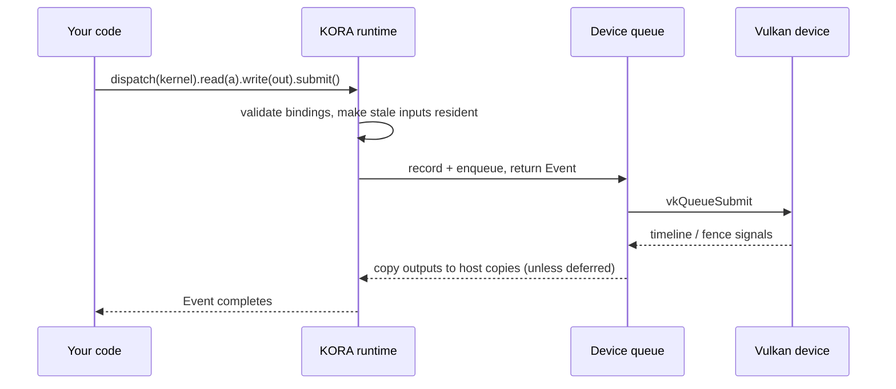

<div class="kora-hero" markdown>

# Vulkan compute you can reason about

KORA turns explicit Vulkan compute into **buffers, kernels, and events** — in Rust, C, or Python.
Every buffer keeps an authoritative host copy, so a dispatch can run on any local GPU or a remote
worker, and a device can disappear mid-stream without losing or corrupting a result.

[Get started](get-started/index.md){ .md-button .md-button--primary }
[Your first dispatch](get-started/quickstart.md){ .md-button }
[GitHub](https://github.com/varunkarthic/kora){ .md-button }

</div>

<div class="grid cards" markdown>

-   :material-chip:{ .lg .middle } __Explicit by default__

    ---

    Kernels are validated SPIR-V bound to a device. You choose where work runs and when bytes move;
    capabilities and limits stay visible.

    [:octicons-arrow-right-24: Core concepts](get-started/concepts.md)

-   :material-swap-horizontal:{ .lg .middle } __Hot-swappable devices__

    ---

    A `Cluster` routes dispatches across every local GPU and remote `kora-worker`s, splits large ones,
    and re-runs work locally when a worker is unplugged.

    [:octicons-arrow-right-24: Multiple devices](guides/cluster.md)

-   :material-language-rust:{ .lg .middle } __Rust core, three APIs__

    ---

    A safe Rust crate, a stable C ABI (`libkora` + `kora.h`), and an abi3 Python wheel with NumPy
    and asyncio support.

    [:octicons-arrow-right-24: API reference](api/index.md)

-   :material-monitor-dashboard:{ .lg .middle } __Watch it live__

    ---

    `kora-top` shows detected devices, where work is going, memory, and every failover as it
    happens.

    [:octicons-arrow-right-24: kora-top](tools/kora-top.md)

-   :material-scale-balance:{ .lg .middle } __Vendor-neutral__

    ---

    Plain Vulkan: no CUDA, ROCm/HIP, oneAPI, or OpenCL. Runtime decisions use queried capabilities
    and measured behavior, never vendor IDs.

    [:octicons-arrow-right-24: Platform support](project/platform-support.md)

-   :material-chart-box-outline:{ .lg .middle } __Measured, not claimed__

    ---

    Every published number comes from retained JSON reports and interleaved runs on a named device.

    [:octicons-arrow-right-24: Performance](performance/index.md)

</div>

## Add two vectors

The same dispatch in each API. The kernel and its manifest live in
[`examples/kernels`](https://github.com/varunkarthic/kora/tree/main/examples/kernels).

=== "Rust"

    ```rust
    use kora::{Runtime, RuntimeOptions, parse_kernel_metadata};
    use kora::kernel::spirv::words_from_bytes;

    let runtime = Runtime::new(&RuntimeOptions::default())?;
    let kernel = runtime.load_kernel(
        &words_from_bytes(include_bytes!("vector_add.spv"))?,
        "main",
        parse_kernel_metadata(include_str!("vector_add.json"))?,
    )?;
    let (a, b, sums) = (
        runtime.create_buffer::<u32>(count)?,
        runtime.create_buffer::<u32>(count)?,
        runtime.create_buffer::<u32>(count)?,
    );
    a.write(&left)?;
    b.write(&right)?;
    runtime.dispatch(&kernel)
        .global(count)
        .read(&a).read(&b).write(&sums)
        .push(&(count as u32))
        .submit()?
        .wait()?;
    let result: Vec<u32> = sums.read()?;
    ```

=== "C"

    ```c
    #include "kora.h"

    KoraRuntime* runtime = NULL;
    kora_runtime_create(NULL, &runtime);
    KoraKernel* kernel = NULL;
    kora_kernel_create_from_file(runtime, "vector_add.spv", "main", manifest_json, &kernel);
    /* create and write buffers a, b, sums ... */
    KoraDispatch* dispatch = NULL;
    KoraEvent* event = NULL;
    kora_dispatch_create(runtime, kernel, &dispatch);
    kora_dispatch_set_global(dispatch, count, 1, 1);
    kora_dispatch_bind(dispatch, a, KORA_ACCESS_READ);
    kora_dispatch_bind(dispatch, b, KORA_ACCESS_READ);
    kora_dispatch_bind(dispatch, sums, KORA_ACCESS_WRITE);
    kora_dispatch_push(dispatch, (const uint8_t*)&count, sizeof count);
    kora_dispatch_submit(dispatch, &event);
    kora_event_wait(event);
    ```

=== "Python"

    ```python
    import numpy as np
    import kora

    runtime = kora.Runtime.create()
    kernel = runtime.load_kernel("vector_add.spv", "main",
                                 kora.KernelMetadata.from_json(manifest_json))
    a = runtime.create_buffer_from(np.arange(count, dtype=np.uint32))
    b = runtime.create_buffer_from(np.full(count, 10, dtype=np.uint32))
    sums = runtime.create_buffer(count * 4)
    (runtime.dispatch(kernel)
        .global_size(count)
        .read(a).read(b).write(sums)
        .push(np.array([count], dtype=np.uint32))
        .submit()
        .wait())
    result = sums.to_numpy(np.uint32)
    ```

## How a dispatch flows



!!! info "Status"
    KORA 1.0 is the Rust rewrite of the 0.x C++ runtime. Releases are published from `main`; a
    release line is **Stable** only once every validation issue in its milestone is closed. See
    [Releases](project/releases.md) and the [migration guide](project/migrating.md).
