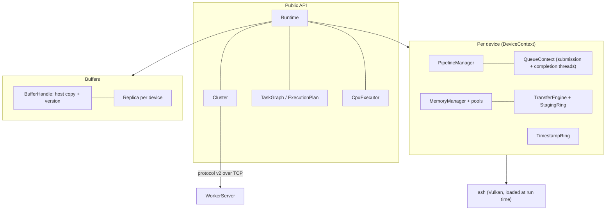

# Architecture

## Layers

| Layer | Modules | Responsibility |
| --- | --- | --- |
| Core types | `error`, `checked`, `log`, `options`, `json`, `metadata`, `verification` | Values every layer shares; no Vulkan |
| Host planning | `event`, `cpu_executor`, `task_graph`, `execution_plan`, `aliasing`, `partition`, `scheduler`, `transfer_model`, `performance_db` | CPU-side models and execution; testable without a device |
| Vulkan bootstrap | `vulkan::{loader, physical, caps, device, fault}` | Loading the loader, owned capability snapshots, logical devices with only queried features |
| Memory | `memory::{suballocator, pool, manager, staging, transfer, dirty, residency, eviction, recovery}` | Device memory and data movement |
| Queues | `vulkan::{queue, command_pool, hazard, ownership}`, `profiling::timestamp` | Ordered submission, completion, barriers, timestamps |
| Kernels | `kernel::{spirv, pipeline, autotuner}` | Validation, reflection, pipeline caches, workgroup tuning |
| Runtime | `runtime::{context, dispatch, replica, calibrate, verify, cpu}`, `buffer`, `placement`, `calibration` | Devices, buffers, dispatch, readback, recovery, adaptive placement |
| Distribution | `cluster`, `remote::{protocol, socket, worker}` | Remote workers, failover, split dispatch, status stream |

Bindings live in separate crates: `kora-capi` (C), `kora-python` (PyO3), and `kora-tools` (CLIs).

## Threads

Per device, a **submission thread** batches and submits recorded command buffers and a **completion
thread** waits on the timeline semaphore (or pooled fences) and runs completion callbacks. Callbacks
copy outputs to host copies, release resources, and complete events. A `Cluster` adds a dispatcher
thread, one thread per worker link, an optional device-rescan monitor, and an optional status thread.
`CpuExecutor` owns its worker threads.

Vulkan objects are destroyed only after both queue threads have exited, so a callback that drops the
last reference to a context never destroys the queue it runs on.

## A dispatch, step by step

1. `submit` validates bindings, push constants, and dimensions against the manifest and device limits.
2. Each binding gets its replica on the kernel's device (created on first use).
3. Inputs whose replica holds an older version than the host copy are uploaded, directly through the
   mapping on unified-memory devices when nothing is pending, otherwise through the staging ring.
4. The hazard tracker emits only the barriers needed against earlier use of each replica.
5. A command buffer is taken from the ring, the descriptor set leased, the dispatch recorded (with
   timestamps when sampled), and the batch handed to the submission thread.
6. On completion, outputs are copied to their host copies if the host still holds the version the
   dispatch started from (or kept on the device with `defer_readback`), resources are released, and
   the event completes.
