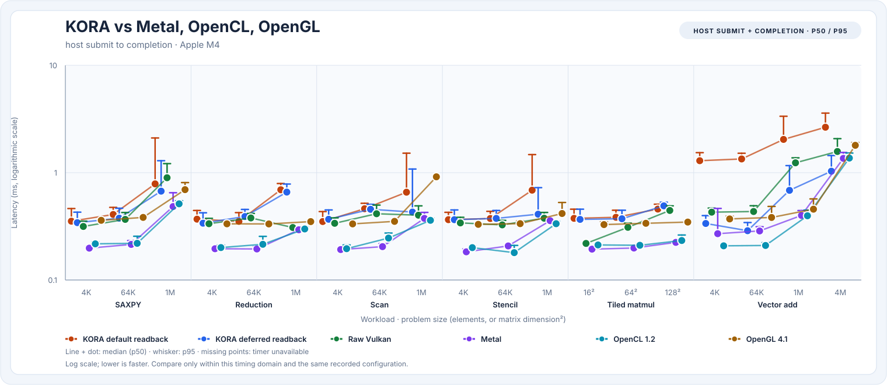
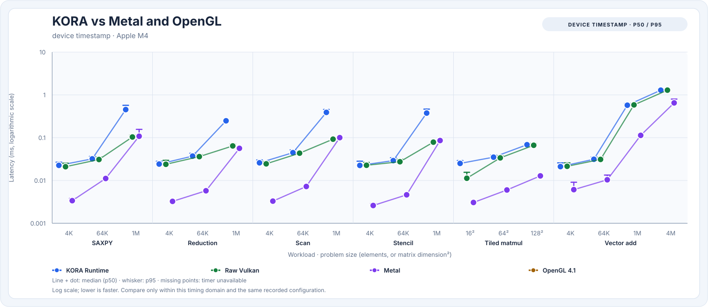

# Against Metal, OpenCL, OpenGL, and Accelerate

!!! note "Measured with KORA 0.3 (C++)"
    This comparison was run before the Rust rewrite. KORA 1.0 measures at parity with 0.3 on the
    same workloads ([Rust vs. C++](rust-vs-cpp.md)), so the conclusions carry over, but the numbers
    below are 0.3's.


This page compares KORA with the other ways to run the same work on the same Apple M4: Metal (the
native GPU API), OpenCL 1.2, OpenGL 4.1, and Apple's Accelerate CPU library, alongside the raw-Vulkan
baseline from [benchmarking](methodology.md). It is one machine and one moment; rerun it before
drawing conclusions for other hardware.

## How it was measured

[`tools/competitor-bench`](https://github.com/varunkarthic/kora/tree/main/tools/competitor-bench) is
an optional macOS-only tool (configure with `-DKORA_BUILD_COMPETITOR_BENCH=ON`). It never links the
KORA library, so Apple frameworks and OpenCL stay out of KORA itself, as the project rules require.
It runs the matched compute suite with the same workloads, sizes, inputs, and output checks as
`kora-bench`: vector add, SAXPY with an input reset each sample, 64-wide reduction, 64-wide tiled
scan, three-point stencil, and 8×8-tiled matrix multiplication. Every sample's output is checked
after the timer stops.

- **Metal** and **OpenCL** use the same kernels as KORA's GLSL fixtures, translated line for line,
  with outputs left in device-visible memory (like KORA deferred and raw Vulkan).
- **OpenGL 4.1**, the newest macOS supports, has no compute shaders. Its rows run vertex shaders with
  transform feedback. Vector add, SAXPY, and stencil map one-to-one, but reduction, scan, and matmul
  loop over their inputs without shared memory, so they are emulations rather than algorithm-matched.
- **Accelerate** is a tuned CPU library that may use several cores. It is compared with KORA's CPU
  baselines, not with GPU latency, and has no 64-wide tiled integer scan.
- **Device time** is each API's own GPU clock: Vulkan timestamp queries, Metal command-buffer GPU
  start/end, and OpenGL `GL_TIME_ELAPSED`. These clocks bracket slightly different work, so compare
  device time within an API rather than across APIs. Apple's OpenCL profiling counters reported
  physically impossible durations (a 1M-element vector add in under 10 µs, above the M4's memory
  bandwidth), so OpenCL device time is not reported.

Six `kora-bench --gpu` runs and six `competitor-bench` runs were interleaved, alternating which ran
first, with 150 samples and 20 warm-ups each, Release, source ce809e4, macOS arm64, Apple M4, KORA on
MoltenVK (`KORA_DEVICE=2`). Values are the median across runs of each run's p50.






## Host submit to completion

| Workload | Size | KORA default | KORA deferred | Raw Vulkan | Metal | OpenCL 1.2 | OpenGL 4.1 | KORA deferred vs fastest other GPU path |
| --- | --- | ---: | ---: | ---: | ---: | ---: | ---: | ---: |
| SAXPY | 4K | 353.167 µs | 342.354 µs | 315.437 µs | 198.020 µs | 217.229 µs | 359.896 µs | 1.73× |
| SAXPY | 64K | 407.833 µs | 376.729 µs | 366.792 µs | 214.417 µs | 219.791 µs | 383.083 µs | 1.76× |
| SAXPY | 1M | 786.520 µs | 672.646 µs | 896.958 µs | 483.583 µs | 512.604 µs | 694.916 µs | 1.39× |
| Reduction | 4K | 369.021 µs | 338.125 µs | 334.458 µs | 195.645 µs | 200.542 µs | 333.791 µs | 1.73× |
| Reduction | 64K | 351.499 µs | 390.083 µs | 378.542 µs | 194.583 µs | 215.000 µs | 333.020 µs | 2.00× |
| Reduction | 1M | 693.458 µs | 659.354 µs | 308.291 µs | 293.895 µs | 298.729 µs | 349.916 µs | 2.24× |
| Scan | 4K | 350.437 µs | 367.854 µs | 337.583 µs | 192.249 µs | 195.750 µs | 333.416 µs | 1.91× |
| Scan | 64K | 461.604 µs | 455.542 µs | 414.250 µs | 204.499 µs | 245.958 µs | 351.854 µs | 2.23× |
| Scan | 1M | 657.541 µs | 429.604 µs | 401.791 µs | 375.041 µs | 359.646 µs | 915.354 µs | 1.19× |
| Stencil | 4K | 364.771 µs | 364.749 µs | 340.645 µs | 182.917 µs | 200.354 µs | 329.937 µs | 1.99× |
| Stencil | 64K | 373.896 µs | 374.979 µs | 326.416 µs | 207.604 µs | 179.937 µs | 335.062 µs | 2.08× |
| Stencil | 1M | 687.166 µs | 410.500 µs | 376.541 µs | 356.979 µs | 334.562 µs | 416.437 µs | 1.23× |
| Tiled matmul | 16² | 375.416 µs | 367.125 µs | 219.146 µs | 193.791 µs | 212.145 µs | 328.312 µs | 1.89× |
| Tiled matmul | 64² | 383.791 µs | 372.187 µs | 309.604 µs | 198.437 µs | 210.604 µs | 337.625 µs | 1.88× |
| Tiled matmul | 128² | 457.917 µs | 490.792 µs | 444.437 µs | 224.291 µs | 233.187 µs | 346.292 µs | 2.19× |
| Vector add | 4K | 1.292 ms | 336.395 µs | 428.521 µs | 270.146 µs | 208.104 µs | 370.750 µs | 1.62× |
| Vector add | 64K | 1.341 ms | 288.063 µs | 434.291 µs | 286.417 µs | 209.812 µs | 382.354 µs | 1.37× |
| Vector add | 1M | 2.041 ms | 684.083 µs | 1.235 ms | 399.374 µs | 396.667 µs | 456.875 µs | 1.72× |
| Vector add | 4M | 2.650 ms | 1.032 ms | 1.575 ms | 1.359 ms | 1.367 ms | 1.798 ms | 0.76× |

## Device time

Apple's OpenCL profiling counters report physically impossible durations on this hardware, so OpenCL has no device-time column. OpenGL timer queries return no value for many small draws; those are gaps.

| Workload | Size | KORA | Raw Vulkan | Metal | OpenGL 4.1 |
| --- | --- | ---: | ---: | ---: | ---: |
| SAXPY | 4K | 22.562 µs | 20.958 µs | 3.374 µs | — |
| SAXPY | 64K | 32.021 µs | 30.937 µs | 11.124 µs | — |
| SAXPY | 1M | 453.812 µs | 103.709 µs | 108.104 µs | — |
| Reduction | 4K | 24.187 µs | 23.875 µs | 3.249 µs | — |
| Reduction | 64K | 37.083 µs | 36.104 µs | 5.750 µs | — |
| Reduction | 1M | 248.354 µs | 64.208 µs | 56.332 µs | — |
| Scan | 4K | 25.854 µs | 24.500 µs | 3.291 µs | — |
| Scan | 64K | 44.708 µs | 43.416 µs | 7.249 µs | — |
| Scan | 1M | 390.458 µs | 92.416 µs | 100.228 µs | — |
| Stencil | 4K | 22.500 µs | 22.687 µs | 2.604 µs | — |
| Stencil | 64K | 29.146 µs | 27.437 µs | 4.624 µs | — |
| Stencil | 1M | 376.125 µs | 78.583 µs | 85.853 µs | — |
| Tiled matmul | 16² | 25.083 µs | 11.271 µs | 3.062 µs | — |
| Tiled matmul | 64² | 35.020 µs | 33.729 µs | 5.999 µs | — |
| Tiled matmul | 128² | 68.562 µs | 66.520 µs | 12.812 µs | — |
| Vector add | 4K | 21.104 µs | 21.437 µs | 6.103 µs | — |
| Vector add | 64K | 31.312 µs | 31.083 µs | 10.374 µs | — |
| Vector add | 1M | 573.875 µs | 584.417 µs | 113.458 µs | — |
| Vector add | 4M | 1.286 ms | 1.290 ms | 649.478 µs | — |

## CPU execution

Accelerate is Apple's tuned CPU library and may use several cores; KORA's CPU rows are its portable single-thread and four-worker baselines. Accelerate has no 64-wide tiled integer scan.

| Workload | Size | KORA CPU (1 thread) | KORA CPU (4 workers) | Accelerate |
| --- | --- | ---: | ---: | ---: |
| SAXPY | 4K | 375 ns | 16.334 µs | 375 ns |
| SAXPY | 64K | 12.167 µs | 20.542 µs | 5.854 µs |
| SAXPY | 1M | 205.104 µs | 66.521 µs | 85.479 µs |
| Reduction | 4K | 917 ns | 15.479 µs | 375 ns |
| Reduction | 64K | 13.979 µs | 19.833 µs | 5.459 µs |
| Reduction | 1M | 222.895 µs | 74.167 µs | 83.437 µs |
| Scan | 4K | 1.291 µs | 16.041 µs | — |
| Scan | 64K | 21.604 µs | 26.896 µs | — |
| Scan | 1M | 360.896 µs | 110.000 µs | — |
| Stencil | 4K | 2.583 µs | 16.354 µs | 791 ns |
| Stencil | 64K | 40.958 µs | 32.166 µs | 11.229 µs |
| Stencil | 1M | 658.853 µs | 209.312 µs | 125.042 µs |
| Tiled matmul | 16² | 1.000 µs | 14.979 µs | 750 ns |
| Tiled matmul | 64² | 54.875 µs | 34.229 µs | 1.520 µs |
| Tiled matmul | 128² | 439.104 µs | 128.041 µs | 6.750 µs |
| Vector add | 4K | 2.083 µs | 17.208 µs | 375 ns |
| Vector add | 64K | 34.333 µs | 19.666 µs | 12.458 µs |
| Vector add | 1M | 564.396 µs | 67.416 µs | 209.750 µs |
| Vector add | 4M | 2.258 ms | — | 1.355 ms |

Metal, OpenCL, and raw Vulkan keep outputs in device-visible memory, like KORA deferred; KORA default also copies outputs back into host buffers (the vector-add rows read back a 16 MiB buffer at every size). OpenGL 4.1 has no compute shaders: its rows run vertex shaders with transform feedback, and its reduction, scan, and matmul loop over inputs without shared memory, so they are not algorithm-matched.

## What this shows

- **Metal is the fastest GPU path for small dispatches here**, completing in about 180–290 µs. KORA
  deferred takes about 290–490 µs, 1.0–2.2× Metal (typically 1.7–2.0×). At 1M elements it is
  1.15–2.2× Metal (the 2.2× is reduction, whose kernel runs long on the device; see #229), and on the
  4M-element vector add KORA deferred is the fastest of all paths (0.76× Metal).
- **Most of that gap is the Vulkan-on-Metal layer, not KORA.** Raw Vulkan through MoltenVK pays the
  same 120–150 µs over Metal, and KORA deferred is now level with raw Vulkan on most small cases after
  #227 and #235.
- **OpenCL tracks Metal closely**; OpenGL 4.1's vertex-shader path lands near raw Vulkan.
- **At 1M elements, KORA's compute kernels run longer on the device than raw Vulkan or Metal** for
  SAXPY, reduction, scan, and stencil; vector add matches. That is tracked in
  [#229](https://github.com/varunkarthic/kora/issues/229).
- **On the CPU, Accelerate wins most rows**, especially matrix multiplication (6.8 µs vs 128 µs for
  KORA's four-worker baseline at 128²) and every 4K–64K case. At 1M elements KORA's four-worker
  baseline is faster for SAXPY (67 vs 85 µs), reduction (74 vs 83 µs), and vector add (67 vs 210 µs),
  while Accelerate keeps stencil (125 vs 209 µs). KORA's CPU code is a portable fallback, not a tuned
  BLAS.

## A faster Vulkan driver on the same GPU

This Mac exposes the same M4 GPU through two Vulkan drivers: MoltenVK (Vulkan on Metal, device 2,
KORA's default here because it reports the higher capability tier) and KosmicKrisp (device 0). Three
alternating 100-sample runs of each showed KORA on KosmicKrisp markedly faster for most small
dispatches (4K reduction 224 vs 377 µs, 4K SAXPY 254 vs 379 µs, 4K vector add 238 vs 351 µs, 4M vector
add 833 vs 1,785 µs), within roughly 15–30% of native Metal, though not uniformly (64K stencil and 64²
matmul were slightly slower). KosmicKrisp does not expose GPU timestamps on this machine, so KORA
keeps its capability-based default; set `KORA_DEVICE=0` to use it. The runs are retained in
[`benchmarks/results/driver-comparison-apple-m4/`](https://github.com/varunkarthic/kora/tree/main/benchmarks/results/driver-comparison-apple-m4).

## Reproduce

On macOS, with the Rust `kora-bench` and the standalone `competitor-bench` harness:

```sh
cargo build --release -p kora-tools
tools/competitor-bench/build.sh            # writes target/competitor-bench
for i in 01 02 03; do
  KORA_DEVICE=1 target/release/kora-bench --gpu --iterations 150 --warmup 20 > kora-$i.json
  target/competitor-bench --iterations 150 --warmup 20 > competitors-$i.json
done
python3 tools/kora-bench/render_competitors.py --kora kora-*.json \
  --competitors competitors-*.json --output-dir docs/assets/charts
```

`KORA_DEVICE` is the MoltenVK device's index in `kora-info` on your machine.

The retained reports behind this page are in
[`benchmarks/results/competitors-apple-m4/`](https://github.com/varunkarthic/kora/tree/main/benchmarks/results/competitors-apple-m4);
`render_competitors.py` reads the compressed files directly.
