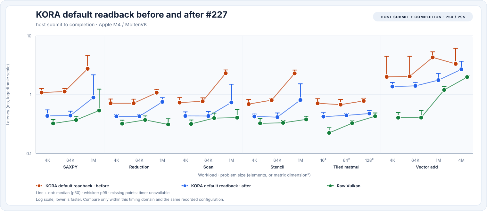
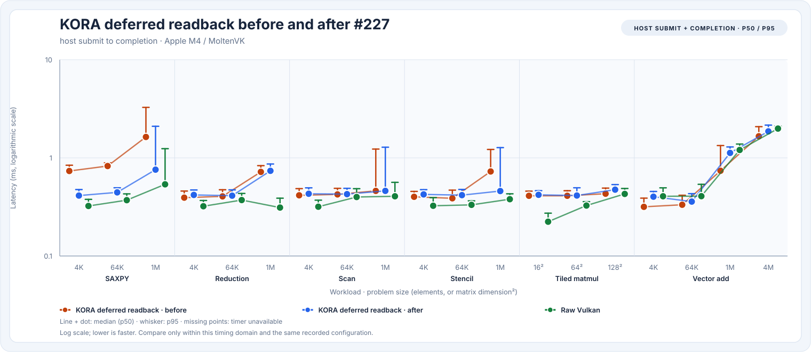
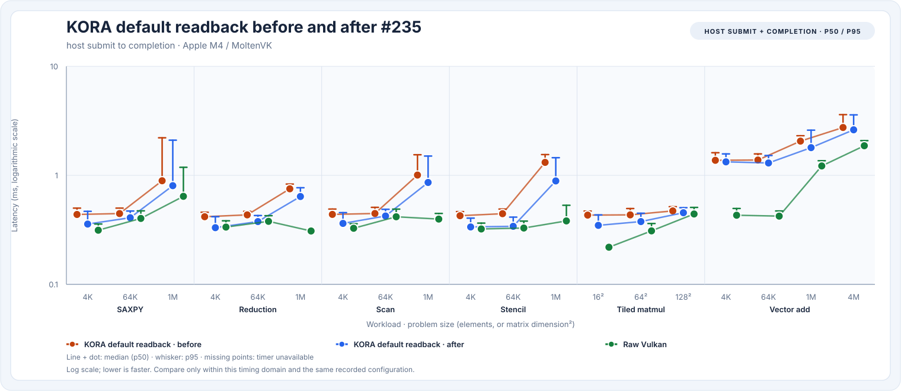

# 0.x optimization history

These studies were measured on the **C++ 0.x runtime** before the Rust rewrite. They explain why the
runtime works the way it does (and the 1.0 port preserved each change). Numbers are host
submit-to-completion latencies on one Apple M4 with MoltenVK unless stated; reports are retained in
[`benchmarks/results`](https://github.com/varunkarthic/kora/tree/main/benchmarks/results).

!!! note
    Compare these only with each other. For 1.0 numbers, see [Rust vs. C++](rust-vs-cpp.md).

## Dispatch overhead case study

The phase profile showed the dominant steady-state host cost was not descriptor setup, transfer, or
command recording, but repeated SPIR-V reflection on an exact pipeline-cache hit. For static-local-size
kernels, KORA now checks the fully serialized pipeline key first and uses the already validated
pipeline when the key matches. Cache misses still perform full reflection and validation; `LocalSizeId`
specializations retain the full path because their resolved workgroup size participates in the key.

| Measurement | Before (`8dd2978`) | After, run 1 (`67bec0f`) | After, run 2 (`67bec0f`) |
| --- | ---: | ---: | ---: |
| 4K KORA deferred-readback host completion, median | 676.500 µs | 523.958 µs | 522.208 µs |
| 4K KORA deferred-readback host completion, p95 | 819.958 µs | 674.041 µs | 597.500 µs |
| 4K raw Vulkan host completion, median | 346.875 µs | 406.708 µs | 465.542 µs |
| KORA/raw 4K host median ratio | 1.95× | 1.29× | 1.12× |
| Pipeline lookup phase, median (diagnostic mode) | 181.667 µs | 6.709 µs | — |

The larger-size medians are included to make possible throughput regressions visible:

| Elements | Path | Before (`8dd2978`) | After, run 1 | After, run 2 |
| ---: | --- | ---: | ---: | ---: |
| 1,048,576 | KORA deferred host completion | 1.383 ms | 1.470 ms | 1.274 ms |
| 1,048,576 | Raw Vulkan host completion | 0.958 ms | 1.191 ms | 0.582 ms |
| 4,194,240 | KORA deferred host completion | 2.876 ms | 2.236 ms | 2.222 ms |
| 4,194,240 | Raw Vulkan host completion | 1.493 ms | 1.714 ms | 2.002 ms |

The ordinary runs used `KORA_DEVICE=2 build/release/tools/kora-bench --gpu --iterations 1000
--warmup 50` on macOS arm64 / Apple M4, AppleClang 21.0.0 Release, Vulkan 1.3.357 / MoltenVK,
with KORA and raw Vulkan pinned to the same enumerated physical device. The pipeline phase uses
`--profile-phases --iterations 200 --warmup 20`; it enables telemetry and must not be compared as a
normal performance result. Its pre-fast-path profile was collected on the profiling branch worktree
before the optimization commit, while the post-fast-path phase sample is on `67bec0f`.

The ordinary 1,000-sample reports preserve every sample and the environment fields:
[before `8dd2978`](https://github.com/varunkarthic/kora/blob/main/benchmarks/results/dispatch-overhead-before-8dd2978-macos-arm64-m4-moltenvk-1000x50.json)
and two reruns after `67bec0f` ([run 1](https://github.com/varunkarthic/kora/blob/main/benchmarks/results/dispatch-overhead-after-67bec0f-macos-arm64-m4-moltenvk-1000x50.json),
[run 2](https://github.com/varunkarthic/kora/blob/main/benchmarks/results/dispatch-overhead-after-67bec0f-repeat-macos-arm64-m4-moltenvk-1000x50.json)).
The KORA 4K/4.19M deferred medians were stable across the two post-change runs, but raw Vulkan and
1M results varied materially with the sequential host/driver state. Treat the ratios as local,
promising evidence rather than a controlled cross-device result or CUDA parity claim. Full raw samples
for 1M and 4.19M vector-add are retained in each report so those variations and possible regressions
remain inspectable.

## Issue #214: eager submission coalescing and completion latency

The completion-phase diagnostic isolated the dominant avoidable delay before the Vulkan queue submit:
Runtime compute queues held a lone, otherwise-ready dispatch for a 100 µs coalescing collection window.
The completion worker's Vulkan timeline wait was still substantial, but timestamp-query collection and
Runtime callback work each measured only a few microseconds. Runtime coalescing now batches compatible
submissions that are already queued together, without waiting for additional future submissions.

The before/after gate used five interleaved Release runs per variant, each with 50 warm-ups and 1,000
timed samples, on the same Apple M4/MoltenVK device (device index 2, Vulkan 1.3.357). Both variants
ran the same shader and input sizes; output correctness checks occur before timed intervals. KORA and
raw Vulkan were explicitly confirmed to use the same physical device. The before binary was built
from `f854b911f9d447488e305c717af67d119427b6e6` and the after binary from
`32c0cb133fc47e5508a3b907b1591cc60c68206f`; both used AppleClang 21.0.0, Release `-O3 -DNDEBUG`.
Each table entry is the median of five run medians; p95 is the median of the five per-run p95s.
These are host submit/completion measurements, not GPU kernel times. KORA device timestamps were
unavailable on this MoltenVK queue, so no KORA-vs-raw GPU execution ratio is inferred.

| Elements | KORA before p50 / p95 | KORA after p50 / p95 | p50 change | Matched raw Vulkan p50 before / after |
| ---: | ---: | ---: | ---: | ---: |
| 4,096 | 547.875 / 612.000 µs | 380.958 / 444.083 µs | −30.5% | 409.500 / 408.042 µs |
| 65,536 | 537.583 / 618.125 µs | 391.583 / 448.792 µs | −27.2% | — |
| 262,144 | 610.750 / 678.834 µs | 432.875 / 541.791 µs | −29.1% | — |
| 1,048,576 | 1.331 / 1.554 ms | 1.093 / 1.314 ms | −17.9% | — |
| 4,194,240 | 2.124 / 2.348 ms | 1.917 / 2.291 ms | −9.7% | — |

At 4K, the KORA/raw median host-latency ratio moved from 1.34× to 0.93× in these five paired
runs. The five-run median of per-run p95s improved by 27.4%; the largest workload showed no
regression in either p50 or p95. The improvement is consistent with removing the idle collection
delay; residual latency is dominated by host/driver queue-completion behavior (diagnostic Vulkan wait
was roughly 316–345 µs), not buffer residency or KORA's completion callback. This M4 result is a
local host-latency comparison only; it does not establish CUDA parity or Linux/Windows hardware-GPU
performance.

All raw samples and environment/device assertions are retained in the five interleaved pairs:
[pair 1 before](https://github.com/varunkarthic/kora/blob/main/benchmarks/results/issue214-before-f854b91-pair-1.json) / [after](https://github.com/varunkarthic/kora/blob/main/benchmarks/results/issue214-after-32c0cb1-pair-1.json),
[pair 2 before](https://github.com/varunkarthic/kora/blob/main/benchmarks/results/issue214-before-f854b91-pair-2.json) / [after](https://github.com/varunkarthic/kora/blob/main/benchmarks/results/issue214-after-32c0cb1-pair-2.json),
[pair 3 before](https://github.com/varunkarthic/kora/blob/main/benchmarks/results/issue214-before-f854b91-pair-3.json) / [after](https://github.com/varunkarthic/kora/blob/main/benchmarks/results/issue214-after-32c0cb1-pair-3.json),
[pair 4 before](https://github.com/varunkarthic/kora/blob/main/benchmarks/results/issue214-before-f854b91-pair-4.json) / [after](https://github.com/varunkarthic/kora/blob/main/benchmarks/results/issue214-after-32c0cb1-pair-4.json), and
[pair 5 before](https://github.com/varunkarthic/kora/blob/main/benchmarks/results/issue214-before-f854b91-pair-5.json) / [after](https://github.com/varunkarthic/kora/blob/main/benchmarks/results/issue214-after-32c0cb1-pair-5.json).

## Issue #227: unified-memory direct access

Before #227, every dirty input upload and every default-mode output readback went through the
staging ring: KORA copied the host shadow into a temporary vector, staged it, submitted a transfer,
and blocked on that transfer before recording the dispatch; default readback added a second
transfer and copy. MoltenVK on Apple M4 was also classified `DiscreteWithBar`, so runtime buffers
used its host-invisible memory type. #227 classifies single-heap devices as unified memory and, on
unified devices, writes and reads host-visible runtime buffers through their mapping whenever no
queued GPU work can access them (see [the memory model](../guides/memory.md#memory-placement)).
It also fixes dropped KORA device timestamps: results that MoltenVK publishes shortly after the
queue signal are now harvested by `Runtime::profiling_stats()`, so the 1,000-sample report has KORA
device timestamps for all 15 matched compute cases (previously 9) and all eight vector-add sizes
(previously none).

Single runs on this machine are not comparable: the same binary's per-run median moved by up to 5×
between runs (for example raw Vulkan 4M vector add ranged 0.84–2.44 ms), apparently with GPU clock
state. The comparison therefore uses 15 interleaved pairs of the `main` build before the change
(63d5f1b) and the change (8ca0de7), alternating which build ran first, with 200–300 measured samples
and 30 warm-ups per run on macOS arm64 / Apple M4, AppleClang 21.0.0 Release, Vulkan 1.3.357 /
MoltenVK. Change is the median of each pair's after/before p50 ratio, followed by how many of the 15
pairs the new build won:

Before: `63d5f1b6a1617fb5324cf306e68fd0f10393aec1` (15 runs); after: `8ca0de7e6b4e87acd1a432fb93293123bf71d22a` (15 runs). Latencies are the median across runs of the per-run p50. Change is the median of per-pair after/before p50 ratios, with the number of pairs the after build won.

| Workload | Size | KORA default before | after | change | KORA deferred before | after | change | Raw Vulkan (after runs) |
| --- | --- | ---: | ---: | ---: | ---: | ---: | ---: | ---: |
| SAXPY | 4K | 1.085 ms | 434.791 µs | -59% (15/15) | 735.417 µs | 412.917 µs | -44% (15/15) | 323.541 µs |
| SAXPY | 64K | 1.129 ms | 441.333 µs | -60% (15/15) | 825.375 µs | 444.833 µs | -46% (14/15) | 370.833 µs |
| SAXPY | 1M | 2.752 ms | 893.375 µs | -60% (13/15) | 1.633 ms | 758.750 µs | -37% (10/15) | 537.458 µs |
| Reduction | 4K | 713.500 µs | 427.167 µs | -40% (14/15) | 392.917 µs | 419.167 µs | +3% (7/15) | 321.417 µs |
| Reduction | 64K | 714.375 µs | 428.541 µs | -42% (14/15) | 405.333 µs | 412.000 µs | +3% (5/15) | 371.792 µs |
| Reduction | 1M | 1.079 ms | 753.000 µs | -29% (15/15) | 719.334 µs | 738.042 µs | +2% (5/15) | 311.667 µs |
| Scan | 4K | 732.375 µs | 434.083 µs | -44% (15/15) | 415.333 µs | 430.584 µs | +4% (6/15) | 317.833 µs |
| Scan | 64K | 771.208 µs | 432.833 µs | -41% (14/15) | 424.417 µs | 426.833 µs | +0% (7/15) | 398.875 µs |
| Scan | 1M | 2.309 ms | 738.209 µs | -46% (13/15) | 460.708 µs | 460.958 µs | +6% (5/15) | 406.041 µs |
| Stencil | 4K | 690.875 µs | 424.666 µs | -41% (15/15) | 401.292 µs | 424.292 µs | +6% (6/15) | 325.208 µs |
| Stencil | 64K | 805.291 µs | 414.500 µs | -45% (15/15) | 387.083 µs | 417.167 µs | -0% (8/15) | 332.166 µs |
| Stencil | 1M | 2.299 ms | 810.416 µs | -49% (12/15) | 727.000 µs | 458.916 µs | +2% (5/15) | 378.958 µs |
| Tiled matmul | 16² | 712.000 µs | 423.125 µs | -40% (15/15) | 410.542 µs | 420.125 µs | +3% (6/15) | 223.500 µs |
| Tiled matmul | 64² | 676.125 µs | 443.083 µs | -37% (14/15) | 410.583 µs | 413.375 µs | +1% (5/15) | 326.500 µs |
| Tiled matmul | 128² | 781.958 µs | 477.375 µs | -40% (15/15) | 431.417 µs | 474.417 µs | +1% (5/15) | 429.167 µs |
| Vector add | 4K | 2.006 ms | 1.374 ms | -32% (13/15) | 316.875 µs | 402.041 µs | +26% (3/15) | 406.041 µs |
| Vector add | 64K | 2.046 ms | 1.409 ms | -32% (14/15) | 333.000 µs | 358.209 µs | +13% (6/15) | 407.375 µs |
| Vector add | 1M | 4.297 ms | 1.764 ms | -56% (14/15) | 738.958 µs | 1.124 ms | +22% (5/15) | 1.203 ms |
| Vector add | 4M | 3.333 ms | 2.696 ms | -15% (12/15) | 1.659 ms | 1.864 ms | +10% (3/15) | 1.988 ms |





Default readback, KORA's default dispatch mode, improved in every case: 15–60% lower median latency,
winning at least 12 of 15 pairs everywhere. Deferred SAXPY, which rewrites its input every sample,
improved 37–46%. Deferred compute workloads that upload nothing changed by −0% to +6%, within run
noise. **Deferred vector add regressed** by 10–26% (the new build won only 3–6 of 15 pairs): its
16 MiB buffers now live in MoltenVK's host-visible memory type, which costs more per dispatch than
the host-invisible type it used before. Direct mapping needs host-visible memory, so this is a
trade-off of the change rather than noise. KORA kernels at 1M elements still execute about 3× longer
than raw Vulkan on MoltenVK by device timestamp (but not on KosmicKrisp); #229 tracks that separately.
These are host-boundary measurements on one device, not kernel-only or CUDA comparisons.

Reproduce with two builds and alternate them; then render the table and charts:

```sh
for i in 01 02 03; do
  KORA_DEVICE=2 before/tools/kora-bench --gpu --iterations 200 --warmup 30 > before-$i.json
  KORA_DEVICE=2 after/tools/kora-bench --gpu --iterations 200 --warmup 30 > after-$i.json
done
python3 tools/kora-bench/render_ab.py --before before-*.json --after after-*.json \
  --output-dir benchmarks/charts
```

All 30 retained reports are in
[`benchmarks/results/issue227-uma-direct/`](https://github.com/varunkarthic/kora/tree/main/benchmarks/results/issue227-uma-direct). At the time
of #227 the snapshot charts and comparison tables came from a separate
1,000-sample/50-warm-up report at 8ca0de7 (they have since been regenerated from later reports),
[retained here](https://github.com/varunkarthic/kora/blob/main/benchmarks/results/macos-arm64-apple-m4-moltenvk-compute-sweep-1000x50-8ca0de7.json).

## Issue #235: GPU timestamps only when needed

The #227 phase profile showed KORA's own host work at about 25 µs of a 4K dispatch; most of the rest
was device completion. Before #235 every dispatch also wrote two GPU timestamp queries, which the
raw-Vulkan, Metal, and OpenCL latency loops do not. Removing them in an experiment build (six
interleaved pairs) cut most small-dispatch latencies by 10–36%, consistent with the driver splitting
its command encoding around each query. KORA now records timestamps only as often as telemetry needs
them (none at `Off`, one dispatch in 16 at the default `Basic`, every dispatch at `Profile`/`Trace`;
autotuning and adaptive observations always record); see [profiling](../guides/profiling.md).

The comparison below uses 10 ABBA-interleaved pairs of `main` before the change (f6e5f15) and the
change (0481ee1), 150 samples and 20 warm-ups per run, at each build's default telemetry level, on
macOS arm64 / Apple M4, AppleClang 21 Release, MoltenVK. Change is the median per-pair p50 ratio and
the number of pairs the new build won:

Before: `f6e5f156b7a9f5ec98953168b37768b08a76266d` (10 runs); after: `0481ee1c2e70d9c0fe586086822854fb7e653afa` (10 runs). Latencies are the median across runs of the per-run p50. Change is the median of per-pair after/before p50 ratios, with the number of pairs the after build won.

| Workload | Size | KORA default before | after | change | KORA deferred before | after | change | Raw Vulkan (after runs) |
| --- | --- | ---: | ---: | ---: | ---: | ---: | ---: | ---: |
| SAXPY | 4K | 437.687 µs | 357.333 µs | -19% (10/10) | 432.271 µs | 351.625 µs | -18% (9/10) | 313.854 µs |
| SAXPY | 64K | 445.979 µs | 408.541 µs | -9% (9/10) | 446.729 µs | 408.604 µs | -10% (9/10) | 402.583 µs |
| SAXPY | 1M | 892.583 µs | 803.979 µs | -2% (5/10) | 705.333 µs | 670.500 µs | -4% (9/10) | 642.395 µs |
| Reduction | 4K | 417.312 µs | 331.020 µs | -18% (8/10) | 430.458 µs | 350.458 µs | -17% (8/10) | 335.333 µs |
| Reduction | 64K | 434.146 µs | 376.791 µs | -11% (9/10) | 410.792 µs | 387.375 µs | -7% (8/10) | 378.729 µs |
| Reduction | 1M | 753.000 µs | 639.646 µs | -13% (10/10) | 728.271 µs | 653.792 µs | -12% (10/10) | 308.750 µs |
| Scan | 4K | 438.354 µs | 362.479 µs | -16% (9/10) | 413.000 µs | 369.458 µs | -14% (9/10) | 326.917 µs |
| Scan | 64K | 446.500 µs | 423.979 µs | -5% (8/10) | 433.312 µs | 418.854 µs | -3% (6/10) | 416.896 µs |
| Scan | 1M | 1.006 ms | 860.749 µs | -14% (7/10) | 444.979 µs | 411.354 µs | -9% (8/10) | 396.916 µs |
| Stencil | 4K | 426.563 µs | 336.084 µs | -20% (10/10) | 425.458 µs | 347.792 µs | -17% (10/10) | 322.271 µs |
| Stencil | 64K | 444.958 µs | 341.021 µs | -27% (10/10) | 431.854 µs | 325.958 µs | -23% (10/10) | 328.854 µs |
| Stencil | 1M | 1.315 ms | 889.375 µs | -14% (8/10) | 432.312 µs | 400.083 µs | -9% (9/10) | 382.166 µs |
| Tiled matmul | 16² | 432.062 µs | 347.583 µs | -16% (10/10) | 443.104 µs | 359.124 µs | -17% (10/10) | 219.124 µs |
| Tiled matmul | 64² | 433.875 µs | 376.938 µs | -12% (8/10) | 425.083 µs | 364.646 µs | -11% (8/10) | 309.541 µs |
| Tiled matmul | 128² | 471.771 µs | 453.958 µs | -5% (8/10) | 462.958 µs | 443.750 µs | -6% (9/10) | 442.437 µs |
| Vector add | 4K | 1.375 ms | 1.331 ms | -3% (7/10) | 382.396 µs | 283.229 µs | -27% (9/10) | 430.895 µs |
| Vector add | 64K | 1.383 ms | 1.299 ms | -2% (8/10) | 417.062 µs | 313.812 µs | -19% (9/10) | 422.729 µs |
| Vector add | 1M | 2.062 ms | 1.796 ms | -3% (6/10) | 855.125 µs | 976.709 µs | -4% (7/10) | 1.220 ms |
| Vector add | 4M | 2.748 ms | 2.619 ms | -2% (5/10) | 1.397 ms | 1.788 ms | -9% (7/10) | 1.870 ms |




Every matched case improved at the median, by 2–27%, and none regressed. Small dispatches gained the
most (for example 4K stencil −17–20% and 4K vector add deferred −27%); 1M-element cases, dominated by
data movement, gained least. KORA deferred is now within a few percent of raw Vulkan for most small
cases. The 20 compressed reports are in
[`benchmarks/results/issue235-timestamps-on-demand/`](https://github.com/varunkarthic/kora/tree/main/benchmarks/results/issue235-timestamps-on-demand);
`render_ab.py` reads `.json.gz` directly:

```sh
python3 tools/kora-bench/render_ab.py \
  --before benchmarks/results/issue235-timestamps-on-demand/before-*.json.gz \
  --after benchmarks/results/issue235-timestamps-on-demand/after-*.json.gz \
  --change "#235" --prefix timestamps-on-demand
```

A second hypothesis, that timeline-semaphore completion is slower than fences on MoltenVK, was
tested the same way (`KORA_FORCE_LEGACY_SYNC=1`, six pairs) and rejected: results moved in both
directions with no consistent winner, so KORA keeps timeline semaphores.

